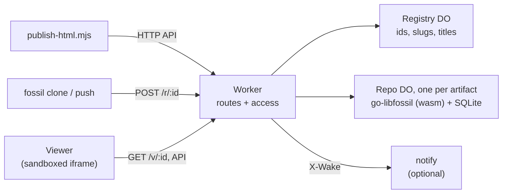

# html-artifact-publisher

A Cloudflare Worker that publishes HTML pages as private, versioned links. Every artifact is a [Fossil](https://fossil-scm.org) repository held by its own SQLite-backed Durable Object: each publish or update is a check-in, a page can have several files, pages can save their own edits and data, and the whole artifact can be cloned with `fossil clone`.

```
you run  →  publish-html.mjs page.html  →  https://<host>/v/<id>#<readToken>      share this
                                           https://<host>/v/<id>#<writeToken>     keep this: it can update
                                           https://editor:<writeToken>@<host>/r/<id>   fossil clone
```

The design, the spike that proved it and the alternatives that were set aside are written up in [the design document](https://claude.ai/artifact/Bf1cJt7wSt7iV9QAn2mst1).

## Run your own

Everything runs on your own Cloudflare account: a Worker, Durable Objects, R2 and Email Service, with no other service required. It costs Cloudflare's Workers Paid plan, **$5 a month**, which covers most personal and team use. **[docs/self-hosting.md](docs/self-hosting.md)** takes you, or an agent working for you, from a fresh clone to a working publisher: costs with examples, the credentials to create, deploying, checking it works, a custom domain, automatic deploys, and pointing your agents at it. Agents can load the `self-host-publisher` skill, which follows the same guide.

## Architecture



**The Repo object** holds one Fossil repository in its own SQLite database: Fossil's real tables (`blob`, `event`, `mlink`, `leaf` and the rest), plus one row naming the artifact and the hashes of its two tokens. [go-libfossil](https://github.com/danmestas/go-libfossil), compiled to WebAssembly with TinyGo (`fossil/`, about 0.9 MB gzipped), runs inside the object and reaches that database through `dosql`, a small `database/sql` driver over the object's synchronous `ctx.storage.sql`. Each request is one call into go-libfossil inside one SQLite transaction, so it either completes or leaves nothing behind.

**The Registry object** maps ids and slugs to artifacts and lists them for the owner. It holds no content.

**The Worker** routes requests and serves the viewer. It never parses Fossil itself.

**The viewer** (`public/viewer.html`, `viewer.js`) loads the chosen check-in through the API and renders it inside a sandboxed iframe with a per-response CSP nonce. It has a History panel, notices when a newer version is published, and gives the page the `window.artifact` API below. The access token never enters the iframe.

### Access

| Who | How | Can |
|-----|-----|-----|
| Legacy owner credential | `Authorization: Bearer <BEARER_TOKEN>` | All artifact operations, including create and list; account administration uses an instance-owner login |
| Read link | token after `#`, sent as `Authorization: Token <t>` | Read every version and the page data; `fossil clone` as `viewer` |
| Edit link | token after `#` | Also publish versions, save page data, delete; `fossil push` as `editor` |
| Anyone else | | Nothing: unknown and forbidden both answer 404, and anonymous clones are refused |

Tokens live in the URL fragment, which browsers send neither to servers nor in `Referer`. A link may end in `@<check-in>` (a hash prefix, tag or branch) to show that version. Content is not encrypted: anyone with access to the Cloudflare account can read it, as with any hosted service.

### Invite-only accounts and library

Open `/` to sign in and browse the library. Configure `OWNER_EMAIL` (the sole instance owner, stable ID `instance-owner`), `APP_ORIGIN` (exact HTTPS origin without a trailing slash), and `EMAIL_FROM` (sender on an onboarded Cloudflare Email Service domain). The Worker sends one-time links with its `send_email` binding named `EMAIL`; verify delivery and domain setup before enabling production sign-in. Login links expire after 15 minutes, are consumed once on explicit confirmation, and establish a seven-day HttpOnly, SameSite=Lax cookie (Secure on HTTPS). Unknown or disabled accounts receive generic responses; there is no registration endpoint.

Email Sending must be enabled for the sender domain on Workers Paid, not just Email Routing with verified destination addresses. Cloudflare's [current sending limits](https://developers.cloudflare.com/email-service/platform/limits/) state that onboarding a sending domain enables arbitrary recipients immediately; without onboarding, only verified destinations work. The unrestricted `EMAIL` binding deliberately has no destination allowlist. The [binding configuration page](https://developers.cloudflare.com/email-service/configuration/send-bindings/) still describes the verified-destination baseline: do not mistake that baseline for an invitation-ready deployment. Before release, send an approved invitation to an external address that is **not** a verified routing destination, confirm receipt and acceptance, and check Email Sending delivery logs. Local tests cannot prove this operational gate.

Changing `OWNER_EMAIL` keeps the stable owner ID and artifact ownership but revokes all prior owner sessions, personal credentials and pending login links on the next account API request. The new address must not already belong to a member; an email uniqueness collision fails closed rather than silently merging accounts. Choose a distinct owner mailbox before deployment.

The instance owner invites members through People and can inspect all artifacts, including private or archived items. Legacy artifacts belong to `instance-owner`. Creators manage named read/write grants and can archive or delete their artifacts. Named edit recipients may update content but cannot manage sharing or delete. Account access never returns capability tokens. Existing explicit edit links, CLI publishing and Fossil sync remain compatible.

Archive only hides an artifact from the ordinary library; it does **not** revoke access or invalidate links. An instance-owner transfer clears named grants, but capability links remain valid. Deletion is permanent. Private means limited to the creator, explicitly named recipients, capability-link holders and the instance owner—not encrypted storage.

Personal API credentials are created in the account menu and displayed once. Use one as `HTML_PUBLISHER_TOKEN` with the existing CLI; new artifacts belong to that account. Revoking a credential prevents further account API access. Disabling a member revokes all sessions, credentials and pending login links. Neither suspension nor credential revocation revokes previously issued artifact capability links.

For isolated local integration tests only, set `TEST_MAIL_TRANSPORT=loopback` and an HTTP loopback `APP_ORIGIN` matching the server origin. The auth request/invitation JSON then includes `loginUrl` instead of sending mail. This transport must never be enabled on a shared server or production deployment. Normal production responses contain no login token. No real email is sent by the account test suite; production delivery is a separate operational verification.

**Publish artifact** in the library takes one HTML page, several files, or a whole folder: the page (`index.html`, or the only HTML file) with its images, styles, scripts, fonts, video and data files such as `.wasm` modules or SQLite databases. Images and other binary or large files go to R2 first, as with the CLI. In the viewer, the ⋯ menu lets editors **upload files** or **a folder** as a new version (files they don't choose stay as they are), and lets anyone who can view it **download the version shown** as a `.zip`, with the real bytes of images and other blobs.

The library offers Recently updated and Name A–Z sorting, filtered totals, visible permission labels, and a saved system/light/dark appearance choice inside the app. The signed-out login screen follows the system theme without a selector and does not overwrite that saved preference. Sorting and filters survive viewer return. Gallery previews use the actual HTML entry file, but are static, script-disabled and isolated; unsupported or oversized content has an explicit fallback. External and multi-file dependent assets are not fetched for previews. Phone lists stay compact and do not load hidden gallery frames. See the [approved mockup control map](docs/mockup-control-map.md) and [parity acceptance evidence](docs/mockup-parity-audit.md).

Account and management API shapes are documented in [`docs/accounts-library-spec.md`](docs/accounts-library-spec.md). Library/inventory queries accept `sort=recent` (default) or `sort=name`; name cursors use the title plus ID, recent cursors use the timestamp plus ID. Sorting is deterministic SQLite NOCASE, not locale-specific Unicode ordering. Libraries and administrative inventories use bounded cursor pagination. Browser writes require a matching Origin; explicit authenticated CLI clients remain supported. Accounts, sessions, grants, stars and audit records live in the existing Registry SQLite Durable Object with additive schema changes; artifact contents remain in their existing Repo objects.

### Cost

On the Workers Paid plan ($5/month) a modest deployment stays inside the included usage: 1M Durable Object requests, 400k GB-s, 25B rows read, 50M rows written and 5 GB stored per month, plus 10 GB of R2 storage for images and large files. 1,000 artifacts of about 1 MB with 100k views and 5k updates a month fit with room to spare. See [docs/self-hosting.md](docs/self-hosting.md#what-it-costs) for rates beyond the included usage and worked examples.

## Prerequisites

- [Node.js 22+](https://nodejs.org/) (CI uses Node 24)
- [Go 1.26+](https://go.dev/dl/) and exactly [TinyGo 0.43.0](https://github.com/tinygo-org/tinygo/releases/tag/v0.43.0) to build the Fossil engine (see [Building the Fossil engine](#building-the-fossil-engine))
- A Cloudflare account on the Workers Paid plan

## Quick start

The full walkthrough is [docs/self-hosting.md](docs/self-hosting.md). In short:

```bash
npm ci
npm run build:wasm                 # fossil/ → src/fossil.wasm, about 0.85 MB gzipped
npm test
npm run deploy:prod                # secrets from Doppler; or export them and run sh scripts/deploy.sh

export HTML_PUBLISHER_URL=https://html-artifact-publisher.<your-subdomain>.workers.dev
export HTML_PUBLISHER_TOKEN=<your-bearer-token>
node scripts/publish-html.mjs --title "My first artifact" my-page.html
```

## Deploying

Merging a pull request into `main` deploys it. `.github/workflows/ci.yml` runs on every pull request and push: typecheck, Go unit tests, the TinyGo build and the end-to-end tests. On a push to `main` its `deploy` job deploys the very build that passed, then checks `/healthz`.

Secrets live in [Doppler](https://www.doppler.com). The deploy job reads them with `doppler run` and uploads the Worker's own secrets with the deploy itself (`wrangler deploy --secrets-file`), so a new version never runs without them. One-time setup:

1. In Doppler, create the project `html-artifact-publisher` with a `prd` config holding:
   - `CLOUDFLARE_API_TOKEN`: a Cloudflare API token from the **Edit Cloudflare Workers** template, with **Workers R2 Storage: Edit** (the first deploy creates the `html-artifact-publisher-blobs` bucket)
   - `CLOUDFLARE_ACCOUNT_ID`
   - `BEARER_TOKEN`: the owner token, e.g. `openssl rand -hex 32`
   - `OWNER_EMAIL`: the explicitly approved instance owner's real email (required secret; never a default/demo identity)
   - `EMAIL_FROM`: the sender address on your onboarded Email Sending domain
   - `APP_ORIGIN`: your deployment's exact external HTTPS origin (no trailing slash)
   - `NOTIFY_API_KEY` (optional)
   - Leave `TEST_MAIL_TRANSPORT` unset/empty. The production deploy script rejects it, checks owner/sender/origin configuration and uploads `OWNER_EMAIL` with the bearer secret. No privileged email is checked into production configuration.
2. Create a Doppler service token for that config, and add it to the GitHub repository as the secret `DOPPLER_TOKEN` (until it exists, merges skip the deploy with a warning), under an environment named `production` (or as a repository secret). Environment protection rules, if you add any, gate every deploy.
3. For a custom domain, add a `routes` entry to `wrangler.jsonc`; otherwise the Worker is served on `workers.dev`.

To deploy by hand with the same secrets: `npm run build:wasm && npm run deploy:prod`. Prefer merging and letting CI deploy: CI builds the engine the same way every time. `deploy.sh` refuses an engine over the size budget.

The Durable Object classes are created by the `v1` migration in `wrangler.jsonc` on the first deploy.

## Local development

```bash
cp .dev.vars.example .dev.vars     # set BEARER_TOKEN and your explicit OWNER_EMAIL
npm run build:wasm
npm run dev                        # http://localhost:8787

npm run test:go                    # driver and size-limit unit tests
npm test                           # end-to-end: API, access, fossil clone/push, CLI
```

The end-to-end tests start their own `wrangler dev` with fresh state, and build `fossil/cmd/fsclient`, a minimal native Fossil client, for the clone and push tests.

## Building the Fossil engine

`npm run build:wasm` compiles `fossil/` with TinyGo into `src/fossil.wasm` (and copies TinyGo's `wasm_exec.js`). Built correctly, it is **about 2.44 MB raw and 0.85 MB gzipped**, the same on Linux and macOS:

1. **`npm ci` first.** It installs Binaryen 132 (`wasm-opt`) from npm, pinned in `package.json`. The build points TinyGo at it (`WASMOPT`) and runs one more `wasm-opt -Oz` pass with it. Don't install Binaryen yourself: TinyGo's macOS release doesn't bundle `wasm-opt`, and a Homebrew one made a 3.07 MB / 1.05 MB build.
2. **TinyGo exactly 0.43.0**, the version CI uses. The build checks it and stops otherwise. On macOS: download the `darwin` release from the link in Prerequisites (Homebrew may give another version); on Linux: the `linux-amd64` tarball, with its `bin/` on `PATH`.
3. **Go from `fossil/go.mod`** (1.26). TinyGo uses it for the standard library.

The build fails if the result is over the size budget, 880,000 bytes gzipped (`FOSSIL_WASM_MAX_GZIP` in `fossil/build.sh`), and `deploy.sh` checks the same budget before deploying. If you hit it, look for the causes above before raising the number; raise it only on purpose, in the same commit as the change that needs it. `GO_COMPILER=go sh fossil/build.sh` builds with standard Go instead (about 2.4 MB gzipped, no budget): for debugging, never for deploying.

## CLI usage

```bash
node scripts/publish-html.mjs [publish] [options] <file.html | dir>
node scripts/publish-html.mjs update <edit-url> <file.html | dir> [--message <text>] [--title <text>]
node scripts/publish-html.mjs read <url>[@<check-in>] [--out <dir>]
node scripts/publish-html.mjs history <url>
node scripts/publish-html.mjs list
node scripts/publish-html.mjs delete <edit-url>
```

A single file is stored as `index.html`; a directory is stored as-is and needs an `index.html` (or another `.html` file). Updating adds and changes files; files missing from the directory are kept from the previous version.

| Flag | Description | Default |
|------|-------------|---------|
| `--title <text>` | Display title | filename |
| `--ttl <duration>` | `1h`, `6h`, `24h`, `7d`, `30d`, `never` | `7d` |
| `--slug <slug>` | Vanity slug `[a-z0-9-]{1,64}` in the URL instead of the id | — |
| `--message <text>` | Check-in comment | `Publish <name>` / `Update <name>` |
| `--delete-local` | Delete the local HTML file after upload | off |
| `--json` | Machine-readable JSON only | off |
| `--copy` / `--no-clipboard` | Force or suppress copying the read link | copy unless `--json` |

`HTML_PUBLISHER_URL` and `HTML_PUBLISHER_TOKEN` are needed for `publish` and `list`; the other commands take everything from the link.

`update` exits with code `3` when someone published after it read the tip: nothing was saved, and running it again builds on the newer version. It exits `1` with "nothing changed" when every file matches the tip.

### Output (`--json`)

```json
{
  "id": "abc123XYZ_def",
  "viewerUrl": "https://<host>/v/abc123XYZ_def#<readToken>",
  "editUrl": "https://<host>/v/abc123XYZ_def#<writeToken>",
  "cloneUrl": "https://editor:<writeToken>@<host>/r/abc123XYZ_def",
  "checkin": "7d20a3563c541938…",
  "expiresAt": "2026-07-31T00:00:00.000Z",
  "warnings": 0,
  "warningMessages": []
}
```

Share `viewerUrl`, after every publish and every update; `update` prints it too, and both check that it opens (`linkVerified`). Keep `editUrl` and `cloneUrl` private.

### Working with Fossil directly

```bash
fossil clone "https://editor:<writeToken>@<host>/r/<id>" page.fossil
fossil open page.fossil && $EDITOR index.html && fossil commit -m "Edit" && fossil push
```

The viewer shows the new check-in at once. Concurrent pushes become two leaves, as in any Fossil repository; the latest is shown. The end-to-end tests exercise clone and push with go-libfossil's own client; the server speaks Fossil's standard sync protocol, which stock `fossil` also uses.

## Pages that save themselves

Inside the viewer, a page can use `window.artifact` (every call returns a promise):

| Call | Does |
|------|------|
| `canWrite()` | `true` when opened with the edit link |
| `files()`, `read(path)` | The files of the version being shown (text) |
| `bytes(path)` | A file's raw bytes, including blobs in R2: hand a `.wasm` module or a SQLite database to a library such as sql.js. Pages may compile WebAssembly |
| `history()` | All check-ins, newest first |
| `publish({ path: text }, message)` | Check in changed files. Rejects if someone else published first; calling again builds on the newer version |
| `data.get(name)`, `data.set(name, value)`, `data.list()` | Small JSON values stored with the artifact but outside its history; last writer wins |
| `pikchr(source)` | Render Pikchr to SVG: `{light, dark, width, height}` |

The viewer's CSP blocks every network request from the page, so bundle everything: relative `<script src>`, stylesheet, image, font and media references to files in the same check-in are inlined when rendering. ES module imports and `fetch()` of relative files are not.

## Diagrams and fonts

The viewer adds two things to a page, and only when the page uses them:

- **Pikchr diagrams.** A page writes [Pikchr](https://pikchr.org) source in `<pre class="pikchr" aria-label="...">`. The viewer renders each block to a light and a dark SVG, which switch with the theme, before showing the page. A block with an error shows the error in its place. Rendering runs Pikchr's wasm (from [Pikchr Studio](https://github.com/danmestas/pikchr-studio), about 56 KB compressed) in a Web Worker, so the page's CSP still blocks WebAssembly. Pages without a diagram never fetch it. `publish` and `update` refuse a page whose diagrams don't render; `node skills/pikchr/render.mjs page.html --check` runs the same check.
- **House fonts.** If a page's CSS names Instrument Sans, IBM Plex Sans, IBM Plex Mono or IBM Plex Serif, the viewer embeds that family (Latin woff2 subsets in `public/fonts/`, SIL OFL). Italic files are added only if the page can show italics, and the Plex Mono and Serif bold files only if it can show bold. A page that declares its own `@font-face` for a family keeps it.

The renderer and fonts are cached by the browser for a week (`public/_headers`).

## Agent wake-up (optional)

An update sent with the header `X-Wake: <kind>` asks the Worker to tell an agent through [notify](https://github.com/danmestas/notify): it posts to `NOTIFY_URL/v1/inbox/conversations/NOTIFY_AGENT/messages` with conversation `artifact-<id>`. Only the id and check-in are sent; the agent pulls the change itself. Set `NOTIFY_URL`, `NOTIFY_AGENT` and optionally `NOTIFY_SUBSCRIBER` in `wrangler.jsonc`, and `wrangler secret put NOTIFY_API_KEY`.

## HTTP API

| Route | Access | Does |
|-------|--------|------|
| `POST /api/artifacts` | owner | Create: `{title, files: {path: base64}, slug?, ttlSeconds?, message?}` → `{id, tip, viewerUrl, editUrl, cloneUrl, expiresAt}` |
| `GET /api/artifacts` | owner | List, most recently updated first |
| `GET /api/artifacts/:id` | read | `{title, role, tip, timeline, expiresAt}`; `?tip` returns only the tip |
| `PUT /api/artifacts/:id` | write | `{parent, files, message?, title?}` → `{tip, parent}`; `409` when `parent` is not the tip |
| `DELETE /api/artifacts/:id` | write | Delete |
| `GET /api/artifacts/:id/bundle?at=` | read | `{checkin, files: {path: base64}, missing, blobs: {path: {sha256, size, type, url}}}`; a blob's `files` entry is its pointer |
| `PUT /api/artifacts/:id/blobs/:sha256` | write | Upload a blob (raw body, `Content-Length` required) before committing its pointer; `HEAD` says whether it is stored |
| `PUT /api/blobs/:sha256` | owner or account | The same, for a new artifact |
| `GET /b/:id/:sha256?exp=&sig=` | signed link | A blob's bytes, with `Range` support |
| `GET /api/artifacts/:id/files/<path>?at=` | read | One file's bytes |
| `GET /api/artifacts/:id/data[/<name>]` | read | Page data names, or one value (`null` when unset) |
| `PUT /api/artifacts/:id/data/<name>` | write | Store a JSON value |
| `POST /r/:id` | Fossil login | Fossil sync protocol |
| `GET /v/:id` | — | The viewer |

## Limits

| Limit | Value | Why |
|-------|-------|-----|
| One blob (images, media, binary files, any file over 256 KB) | 100 MB | `MAX_BLOB_BYTES`; Workers accept request bodies up to 100 MB. Stored in R2, not Fossil |
| One text file in Fossil, compressed | about 1.99 MB | A Durable Object's SQLite holds at most 2 MB per value, and Fossil stores each file in one row. Larger files are refused with `413` (API) or a sync error (`fossil push`); the CLI sends any file over 256 KB to R2, so this only applies to files pushed with `fossil` or posted to the API directly |
| Request body | 10 MB | `MAX_PAYLOAD_BYTES` |
| Default / max TTL | 7 days / 30 days, or `--ttl never` | `DEFAULT_TTL_SECONDS`, `MAX_TTL_SECONDS`; expiry is a Durable Object alarm |
| Repository | 10 GB | Per Durable Object |

A `fossil push` that includes an oversized file is refused, but if Fossil sent the check-in in an earlier round than the file, that check-in arrives without the file. The viewer then shows the other files, and the bundle lists the gap under `missing`.

## Images and large files (blobs)

Images, video, audio, fonts, PDFs and other binary files, and any file over 256 KB, are stored in R2 (binding `BLOBS`) by their SHA-256, not in Fossil. Fossil keeps a small pointer file at the file's own path, so pages still say `` and history stays correct:

```
artifact-blob 1
sha256 9f2c41…d7e1
size 4718231
type image/jpeg
```

- **Publishing.** `public/client.js` (the CLI, and pages that save themselves) uploads each such file first, to `PUT /api/blobs/<sha256>` (new artifact; owner or account) or `PUT /api/artifacts/<id>/blobs/<sha256>` (edit link), then commits the pointer. The Worker hashes the bytes as they stream in and refuses a mismatch; a commit naming a blob R2 doesn't have is refused with `missing_blob`. Identical bytes are stored once.
- **Viewing.** The bundle lists each blob with a signed link, `/b/<id>/<sha256>?exp=&sig=`, signed with a key derived from `BEARER_TOKEN`. A link stays the same for a day (so browsers cache what it serves) and is never valid for more than 48 hours. The viewer points images, media and fonts at these links (the page CSP allows `/b/` and nothing else), and fetches and inlines large scripts and stylesheets. Links support `Range`, so video can stream.
- **Cleanup.** The Registry records which artifacts point at which blobs; a blob is deleted from R2 with the last artifact that points at it. Pointers pushed with `fossil` are recorded when the artifact is next viewed.
- **`fossil clone`** gets the pointer files, not the bytes. `publish-html.mjs read <url> --out <dir>` writes the real files.


## Safety model

| Property | How |
|----------|-----|
| Access | Owner bearer token, or per-artifact read and write tokens compared by SHA-256 hash with timing-safe equality. Fossil logins `viewer` and `editor` use the same tokens; `nobody` and `anonymous` have no capabilities |
| Atomic requests | Each request runs in one SQLite transaction; any error rolls it back |
| Lost updates | API updates must name the tip they started from (`409` otherwise); Fossil pushes fork instead of overwriting |
| Viewer sandboxing | `<iframe sandbox="allow-scripts allow-forms allow-modals allow-popups">` with an opaque origin; it cannot read the token |
| CSP | Per-response nonce on the page's scripts and styles; `default-src 'none'` and `connect-src 'self'` |
| No indexing | `X-Robots-Tag: noindex, nofollow` and `Referrer-Policy: no-referrer` on every response |

**Not protected:** content is stored unencrypted on Cloudflare, and anyone holding a link has its access until the artifact is deleted or expires.

## Repo layout

```
.
├── .github/workflows/ci.yml   Checks on every PR; deploy on merge to main
├── src/
│   ├── index.ts               Worker: routes, access, viewer
│   ├── repo.ts                Repo Durable Object (one per artifact)
│   ├── registry.ts            Registry Durable Object
│   ├── blobs.ts               Blobs in R2: upload, signed links, pointer checks
│   ├── fossil.ts              Loads the wasm; one transaction per call
│   └── util.ts
├── fossil/                    go-libfossil server program (Go module)
│   ├── main_js.go             Operations: create, commit, bundle, sync, …
│   ├── dosql_js.go            database/sql driver over ctx.storage.sql
│   ├── classify.go            What the driver emulates (unit-tested)
│   ├── limits.go              The one-row size limit (unit-tested)
│   ├── cmd/fsclient/          Native Fossil client for the e2e tests
│   └── build.sh               TinyGo (default) or Go build
├── public/                    Viewer shell, the shared API client, Pikchr (pikchr/,
│                              diagrams.js), the house fonts (fonts/, fonts.js) and
│                              blobs.js (which files go to R2; the pointer format)
├── scripts/                   publish-html.mjs (CLI), pikchr.mjs (diagram check), deploy.sh
├── test/                      End-to-end and Pikchr tests
├── AGENTS.md, CLAUDE.md       Build, test and deploy rules for agents working on this repo
├── skills/, agent-harnesses/, docs/   Instructions for agents (publish-html-page,
│                                      artifact-design, -runtime, -diagrams, -dataviz,
│                                      pikchr, self-host-publisher); docs/self-hosting.md
└── wrangler.jsonc
```
