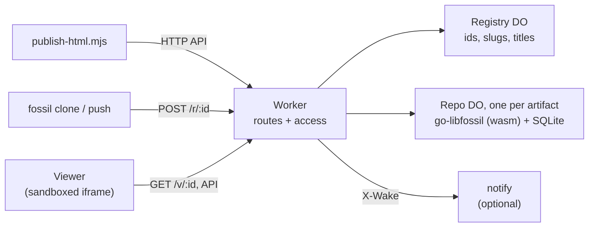

# html-artifact-publisher

A Cloudflare Worker that publishes HTML pages as private, versioned links. Every artifact is a [Fossil](https://fossil-scm.org) repository held by its own SQLite-backed Durable Object: each publish or update is a check-in, a page can have several files, pages can save their own edits and data, and the whole artifact can be cloned with `fossil clone`.

```
you run  →  publish-html.mjs page.html  →  https://<host>/v/<id>#<readToken>      share this
                                           https://<host>/v/<id>#<writeToken>     keep this: it can update
                                           https://editor:<writeToken>@<host>/r/<id>   fossil clone
```

The design, the spike that proved it and the alternatives that were set aside are written up in [the design document](https://claude.ai/artifact/Bf1cJt7wSt7iV9QAn2mst1).

## Architecture



**The Repo object** holds one Fossil repository in its own SQLite database: Fossil's real tables (`blob`, `event`, `mlink`, `leaf` and the rest), plus one row naming the artifact and the hashes of its two tokens. [go-libfossil](https://github.com/danmestas/go-libfossil), compiled to WebAssembly with TinyGo (`fossil/`, about 0.9 MB gzipped), runs inside the object and reaches that database through `dosql`, a small `database/sql` driver over the object's synchronous `ctx.storage.sql`. Each request is one call into go-libfossil inside one SQLite transaction, so it either completes or leaves nothing behind.

**The Registry object** maps ids and slugs to artifacts and lists them for the owner. It holds no content.

**The Worker** routes requests and serves the viewer. It never parses Fossil itself.

**The viewer** (`public/viewer.html`, `viewer.js`) loads the chosen check-in through the API and renders it inside a sandboxed iframe with a per-response CSP nonce. It has a History panel, notices when a newer version is published, and gives the page the `window.artifact` API below. The access token never enters the iframe.

### Access

| Who | How | Can |
|-----|-----|-----|
| Owner | `Authorization: Bearer <BEARER_TOKEN>` | Everything, including create and list |
| Read link | token after `#`, sent as `Authorization: Token <t>` | Read every version and the page data; `fossil clone` as `viewer` |
| Edit link | token after `#` | Also publish versions, save page data, delete; `fossil push` as `editor` |
| Anyone else | | Nothing: unknown and forbidden both answer 404, and anonymous clones are refused |

Tokens live in the URL fragment, which browsers send neither to servers nor in `Referer`. A link may end in `@<check-in>` (a hash prefix, tag or branch) to show that version. Content is not encrypted: anyone with access to the Cloudflare account can read it, as with any hosted service.

### Cost

On the Workers Paid plan ($5/month) a modest deployment stays inside the included usage: 1M Durable Object requests, 400k GB-s, 25B rows read, 50M rows written and 5 GB stored per month. 1,000 artifacts of about 1 MB with 100k views and 5k updates a month fit with room to spare. The design document has the details.

## Prerequisites

- [Node.js 22+](https://nodejs.org/) (CI uses Node 24)
- [Go 1.26+](https://go.dev/dl/) and [TinyGo 0.43+](https://tinygo.org/getting-started/install/) to build the Fossil engine (set `GO_COMPILER=go` to build with standard Go instead: larger, no TinyGo needed)
- A Cloudflare account on the Workers Paid plan

## Quick start

```bash
npm install
npm run build:wasm                 # fossil/ → src/fossil.wasm
npm run deploy:prod                # secrets from Doppler (see Deploying)

export HTML_PUBLISHER_URL=https://html-artifact-publisher.<your-subdomain>.workers.dev
export HTML_PUBLISHER_TOKEN=<your-bearer-token>
node scripts/publish-html.mjs --title "My first artifact" my-page.html
```

## Deploying

Merging a pull request into `main` deploys it. `.github/workflows/ci.yml` runs on every pull request and push: typecheck, Go unit tests, the TinyGo build and the end-to-end tests. On a push to `main` its `deploy` job deploys the very build that passed, then checks `/healthz`.

Secrets live in [Doppler](https://www.doppler.com). The deploy job reads them with `doppler run` and uploads the Worker's own secrets with the deploy itself (`wrangler deploy --secrets-file`), so a new version never runs without them. One-time setup:

1. In Doppler, create the project `html-artifact-publisher` with a `prd` config holding:
   - `CLOUDFLARE_API_TOKEN`: a Cloudflare API token from the **Edit Cloudflare Workers** template
   - `CLOUDFLARE_ACCOUNT_ID`
   - `BEARER_TOKEN`: the owner token, e.g. `openssl rand -hex 32`
   - `NOTIFY_API_KEY` (optional)
2. Create a Doppler service token for that config, and add it to the GitHub repository as the secret `DOPPLER_TOKEN` (until it exists, merges skip the deploy with a warning), under an environment named `production` (or as a repository secret). Environment protection rules, if you add any, gate every deploy.
3. For a custom domain, add a `routes` entry to `wrangler.jsonc`; otherwise the Worker is served on `workers.dev`.

To deploy by hand with the same secrets: `npm run build:wasm && npm run deploy:prod`.

The Durable Object classes are created by the `v1` migration in `wrangler.jsonc` on the first deploy.

## Local development

```bash
cp .dev.vars.example .dev.vars     # set BEARER_TOKEN to any local value
npm run build:wasm
npm run dev                        # http://localhost:8787

npm run test:go                    # driver and size-limit unit tests
npm test                           # end-to-end: API, access, fossil clone/push, CLI
```

The end-to-end tests start their own `wrangler dev` with fresh state, and build `fossil/cmd/fsclient`, a minimal native Fossil client, for the clone and push tests.

## CLI usage

```bash
node scripts/publish-html.mjs [publish] [options] <file.html | dir>
node scripts/publish-html.mjs update <edit-url> <file.html | dir> [--message <text>] [--title <text>]
node scripts/publish-html.mjs read <url>[@<check-in>] [--out <dir>]
node scripts/publish-html.mjs history <url>
node scripts/publish-html.mjs list
node scripts/publish-html.mjs delete <edit-url>
```

A single file is stored as `index.html`; a directory is stored as-is and needs an `index.html` (or another `.html` file). Updating adds and changes files; files missing from the directory are kept from the previous version.

| Flag | Description | Default |
|------|-------------|---------|
| `--title <text>` | Display title | filename |
| `--ttl <duration>` | `1h`, `6h`, `24h`, `7d`, `30d`, `never` | `7d` |
| `--slug <slug>` | Vanity slug `[a-z0-9-]{1,64}` in the URL instead of the id | — |
| `--message <text>` | Check-in comment | `Publish <name>` / `Update <name>` |
| `--delete-local` | Delete the local HTML file after upload | off |
| `--json` | Machine-readable JSON only | off |
| `--copy` / `--no-clipboard` | Force or suppress copying the read link | copy unless `--json` |

`HTML_PUBLISHER_URL` and `HTML_PUBLISHER_TOKEN` are needed for `publish` and `list`; the other commands take everything from the link.

`update` exits with code `3` when someone published after it read the tip: nothing was saved, and running it again builds on the newer version. It exits `1` with "nothing changed" when every file matches the tip.

### Output (`--json`)

```json
{
  "id": "abc123XYZ_def",
  "viewerUrl": "https://<host>/v/abc123XYZ_def#<readToken>",
  "editUrl": "https://<host>/v/abc123XYZ_def#<writeToken>",
  "cloneUrl": "https://editor:<writeToken>@<host>/r/abc123XYZ_def",
  "checkin": "7d20a3563c541938…",
  "expiresAt": "2026-07-31T00:00:00.000Z",
  "warnings": 0,
  "warningMessages": []
}
```

Share `viewerUrl`. Keep `editUrl` and `cloneUrl` private.

### Working with Fossil directly

```bash
fossil clone "https://editor:<writeToken>@<host>/r/<id>" page.fossil
fossil open page.fossil && $EDITOR index.html && fossil commit -m "Edit" && fossil push
```

The viewer shows the new check-in at once. Concurrent pushes become two leaves, as in any Fossil repository; the latest is shown. The end-to-end tests exercise clone and push with go-libfossil's own client; the server speaks Fossil's standard sync protocol, which stock `fossil` also uses.

## Pages that save themselves

Inside the viewer, a page can use `window.artifact` (every call returns a promise):

| Call | Does |
|------|------|
| `canWrite()` | `true` when opened with the edit link |
| `files()`, `read(path)` | The files of the version being shown |
| `history()` | All check-ins, newest first |
| `publish({ path: text }, message)` | Check in changed files. Rejects if someone else published first; calling again builds on the newer version |
| `data.get(name)`, `data.set(name, value)`, `data.list()` | Small JSON values stored with the artifact but outside its history; last writer wins |

The viewer's CSP blocks every network request from the page, so bundle everything: relative `<script src>`, stylesheet, image, font and media references to files in the same check-in are inlined when rendering. ES module imports and `fetch()` of relative files are not.

## Agent wake-up (optional)

An update sent with the header `X-Wake: <kind>` asks the Worker to tell an agent through [notify](https://github.com/danmestas/notify): it posts to `NOTIFY_URL/v1/inbox/conversations/NOTIFY_AGENT/messages` with conversation `artifact-<id>`. Only the id and check-in are sent; the agent pulls the change itself. Set `NOTIFY_URL`, `NOTIFY_AGENT` and optionally `NOTIFY_SUBSCRIBER` in `wrangler.jsonc`, and `wrangler secret put NOTIFY_API_KEY`.

## HTTP API

| Route | Access | Does |
|-------|--------|------|
| `POST /api/artifacts` | owner | Create: `{title, files: {path: base64}, slug?, ttlSeconds?, message?}` → `{id, tip, viewerUrl, editUrl, cloneUrl, expiresAt}` |
| `GET /api/artifacts` | owner | List, most recently updated first |
| `GET /api/artifacts/:id` | read | `{title, role, tip, timeline, expiresAt}`; `?tip` returns only the tip |
| `PUT /api/artifacts/:id` | write | `{parent, files, message?, title?}` → `{tip, parent}`; `409` when `parent` is not the tip |
| `DELETE /api/artifacts/:id` | write | Delete |
| `GET /api/artifacts/:id/bundle?at=` | read | `{checkin, files: {path: base64}, missing}` |
| `GET /api/artifacts/:id/files/<path>?at=` | read | One file's bytes |
| `GET /api/artifacts/:id/data[/<name>]` | read | Page data names, or one value (`null` when unset) |
| `PUT /api/artifacts/:id/data/<name>` | write | Store a JSON value |
| `POST /r/:id` | Fossil login | Fossil sync protocol |
| `GET /v/:id` | — | The viewer |

## Limits

| Limit | Value | Why |
|-------|-------|-----|
| One file, compressed | about 1.99 MB | A Durable Object's SQLite holds at most 2 MB per value, and Fossil stores each file in one row. Larger files are refused with `413` (API) or a sync error (`fossil push`) |
| Request body | 10 MB | `MAX_PAYLOAD_BYTES` |
| Default / max TTL | 7 days / 30 days, or `--ttl never` | `DEFAULT_TTL_SECONDS`, `MAX_TTL_SECONDS`; expiry is a Durable Object alarm |
| Repository | 10 GB | Per Durable Object |

A `fossil push` that includes an oversized file is refused, but if Fossil sent the check-in in an earlier round than the file, that check-in arrives without the file. The viewer then shows the other files, and the bundle lists the gap under `missing`. Storing large files in pieces belongs in go-libfossil and is planned.

## Safety model

| Property | How |
|----------|-----|
| Access | Owner bearer token, or per-artifact read and write tokens compared by SHA-256 hash with timing-safe equality. Fossil logins `viewer` and `editor` use the same tokens; `nobody` and `anonymous` have no capabilities |
| Atomic requests | Each request runs in one SQLite transaction; any error rolls it back |
| Lost updates | API updates must name the tip they started from (`409` otherwise); Fossil pushes fork instead of overwriting |
| Viewer sandboxing | `<iframe sandbox="allow-scripts allow-forms allow-modals allow-popups">` with an opaque origin; it cannot read the token |
| CSP | Per-response nonce on the page's scripts and styles; `default-src 'none'` and `connect-src 'self'` |
| No indexing | `X-Robots-Tag: noindex, nofollow` and `Referrer-Policy: no-referrer` on every response |

**Not protected:** content is stored unencrypted on Cloudflare, and anyone holding a link has its access until the artifact is deleted or expires.

## Repo layout

```
.
├── .github/workflows/ci.yml   Checks on every PR; deploy on merge to main
├── src/
│   ├── index.ts               Worker: routes, access, viewer
│   ├── repo.ts                Repo Durable Object (one per artifact)
│   ├── registry.ts            Registry Durable Object
│   ├── fossil.ts              Loads the wasm; one transaction per call
│   └── util.ts
├── fossil/                    go-libfossil server program (Go module)
│   ├── main_js.go             Operations: create, commit, bundle, sync, …
│   ├── dosql_js.go            database/sql driver over ctx.storage.sql
│   ├── classify.go            What the driver emulates (unit-tested)
│   ├── limits.go              The one-row size limit (unit-tested)
│   ├── cmd/fsclient/          Native Fossil client for the e2e tests
│   └── build.sh               TinyGo (default) or Go build
├── public/                    Viewer shell and the shared API client
├── scripts/                   publish-html.mjs (CLI), deploy.sh (deploy with secrets from the environment)
├── test/e2e.test.mjs          End-to-end tests
├── skills/, agent-harnesses/, docs/   Instructions for agents (publish-html-page,
│                                      artifact-design, -runtime, -diagrams, -dataviz)
└── wrangler.jsonc
```
