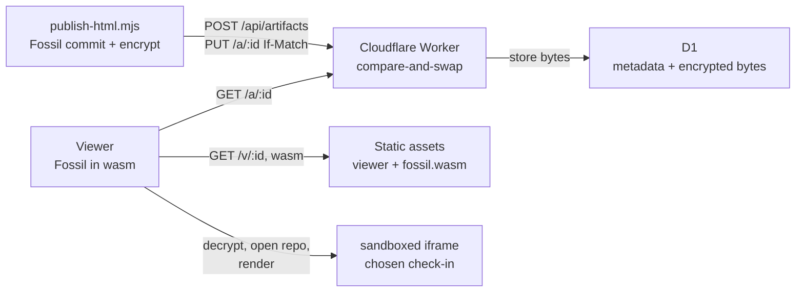

# html-artifact-publisher

A Cloudflare Worker that publishes standalone HTML pages as shareable, encrypted, versioned URLs. Each artifact is a [Fossil](https://fossil-scm.org) repository, encrypted before upload: every publish is a check-in, so a page keeps its full history, can hold several files, and can save edits made inside the page. The decryption key lives only in the URL fragment; titles, source names, slugs, timestamps and sizes remain plaintext metadata.

```
you run  →  commit + encrypt locally  →  upload  →  get https://your.domain/v/abc123#<key>
                                                                            ↑
                                        key never leaves the browser ───────┘
```

## Why encrypted by default

Artifacts often contain work-in-progress content, agent outputs, or data you don't want indexed, cached, or visible to the hosting provider. Encrypting before upload means:

- **Payload stays opaque.** D1 stores `iv || AES-256-GCM(gzip(repository))`. The Worker cannot read the pages, their history, or their data, even if compromised; only uploader-provided metadata remains plaintext.
- **Key is transport-opaque.** URL fragments are not sent to servers in HTTP requests. The key travels only browser-side.
- **No key rotation complexity.** Each artifact gets its own fresh 256-bit key, kept for all its versions so the link never changes. Revocation is deletion.
- **Share by copy.** The URL *is* the access credential.

The tradeoff: if you lose the URL you lose the key. There is no recovery. That is intentional.

## Architecture



**The artifact** is a `.fossil` file (a SQLite database). Check-ins are versions; a multi-file page is a check-in with several files; page data and uploads are unversioned files. It is gzipped, encrypted, and stored as one opaque value.

**Fossil runs on the client.** [go-libfossil](https://github.com/danmestas/go-libfossil), compiled to WebAssembly (`public/fossil.wasm.gz`, built by `wasm/build.sh`), runs in the viewer and in the CLI. The server never runs Fossil and never sees plaintext.

**The Worker** is a byte store with compare-and-swap. Every stored version has a random ETag; a write must name the ETag it was based on (`If-Match`), otherwise it is refused with `412` and nothing changes. It also serves the viewer with a fresh CSP nonce.

**D1** holds one `artifacts` row per artifact and its bytes in 1 MiB `chunks` rows. A write is one D1 batch (a transaction), so a lost race changes nothing. Expired artifacts read as absent and are swept on the next publish; there is no cron.

**The viewer** (`public/viewer.html`, `viewer.js`) fetches the bytes, decrypts them with the fragment key, opens the repository in wasm and renders the trunk tip, or the check-in named after `@` in the fragment, inside a sandboxed iframe. It has a History panel, notices when a newer version is saved, and gives the page a small `window.artifact` API (below). The key never enters the iframe.

### Links

| Link | Can |
|------|-----|
| `/v/<id>#<key>` | Read every version |
| `/v/<id>#<key>.<writeToken>` | Read, publish new versions, save page data, delete |
| `…@<check-in>` | Show that check-in (a hash prefix, tag or branch) instead of the tip |

### Cost

Everything fits the Workers Free plan, which does not bill: at a limit, requests fail until the next day.

| Piece | Free plan |
|-------|-----------|
| Worker | 100k requests/day, 10 ms CPU per request; the Worker is small and does no crypto on bodies |
| Static assets (viewer, wasm) | Served without running the Worker |
| D1 | 5 GB per account, 100k rows written/day; check the per-database size limit for your plan |

No R2 bucket, Durable Object or cron is needed.

## Prerequisites

- [Node.js 22+](https://nodejs.org/) (Node 24 is used in CI)
- [Wrangler CLI](https://developers.cloudflare.com/workers/wrangler/install-and-update/) authenticated with your Cloudflare account
- A Cloudflare account with Workers and D1 enabled
- To rebuild the wasm only: Go 1.26+

## Quick start

```bash
# 1. Install
npm install

# 2. Create the database (run once)
wrangler d1 create html-artifact-publisher    # copy the database_id into wrangler.jsonc
wrangler d1 migrations apply html-artifact-publisher --remote

# 3. Set the secret bearer token
wrangler secret put BEARER_TOKEN              # paste a strong random token when prompted

# 4. Deploy
npm run deploy

# 5. Publish your first artifact
export HTML_PUBLISHER_URL=https://<your-worker-domain>
export HTML_PUBLISHER_TOKEN=<your-bearer-token>
node scripts/publish-html.mjs --title "My first artifact" my-page.html
# → prints the read link (copied to clipboard) and a private edit link
```

## Cloudflare setup

All commands run from the repo root.

1. **Install dependencies:** `npm install`
2. **Create the D1 database:** `wrangler d1 create html-artifact-publisher`, then paste the `database_id` into `wrangler.jsonc`.
3. **Set the public base URL:** in `wrangler.jsonc`, set `vars.PUBLIC_BASE_URL` to your domain and update `routes` if you use a custom domain.
4. **Run migrations:** `wrangler d1 migrations apply html-artifact-publisher --remote` (add `--local` for local dev).
5. **Set the bearer token:** `wrangler secret put BEARER_TOKEN` (e.g. from `openssl rand -hex 32`).
6. **Deploy:** `npm run deploy`, then `curl https://<your-domain>/healthz`.

### Upgrading from 0.1 (R2 + `pages` table)

Migration `0002_artifacts.sql` drops the old `pages` table. Artifacts published by 0.1 stop resolving; republish anything you still need. The R2 bucket is no longer used and can be deleted.

## Local development

```bash
cp .dev.vars.example .dev.vars     # set BEARER_TOKEN to any local test value
wrangler d1 migrations apply html-artifact-publisher --local
npm run dev                        # http://localhost:8787, local D1

HTML_PUBLISHER_URL=http://localhost:8787 \
HTML_PUBLISHER_TOKEN=your-local-token \
  node scripts/publish-html.mjs my-artifact.html
```

## CLI usage

```bash
node scripts/publish-html.mjs [publish] [options] <file.html | dir>
node scripts/publish-html.mjs update <edit-url> <file.html | dir> [--message <text>] [--title <text>]
node scripts/publish-html.mjs read <url> [--out <dir>]
node scripts/publish-html.mjs history <url>
node scripts/publish-html.mjs list
node scripts/publish-html.mjs delete <edit-url>
```

A single file is stored as `index.html`; a directory is stored as-is and needs an `index.html` (or another `.html` file). Updating with a directory adds and changes files; files missing from the directory are kept from the previous version.

**Publish options:**

| Flag | Description | Default |
|------|-------------|---------|
| `--title <text>` | Display title | filename |
| `--ttl <duration>` | `1h`, `6h`, `24h`, `7d`, `30d`, `never` | `7d` |
| `--slug <slug>` | Vanity slug `[a-z0-9-]{1,64}` — appears in URL instead of random ID | — |
| `--message <text>` | Check-in comment | `Publish <name>` / `Update <name>` |
| `--delete-local` | Delete the local HTML file after confirmed upload | off |
| `--json` | Machine-readable JSON on stdout; no human output | off |
| `--copy` | Copy the read link to clipboard even when `--json` is set | off |
| `--no-clipboard` | Suppress clipboard in any mode | off |

**Environment variables:** `HTML_PUBLISHER_URL` and `HTML_PUBLISHER_TOKEN` are required for `publish` and `list`. `update`, `read`, `history` and `delete` take everything they need from the link.

### Examples

```bash
# Publish; prints the result and copies the read link to the clipboard
node scripts/publish-html.mjs report.html

# A multi-file page with a title, 30-day TTL and vanity slug
node scripts/publish-html.mjs --title "Q2 Results" --ttl 30d --slug q2-results ./report/

# Publish a new version at the same URL
node scripts/publish-html.mjs update "$EDIT_URL" report.html --message "Fix totals"

# See the versions, and read an old one
node scripts/publish-html.mjs history "$URL"
node scripts/publish-html.mjs read "$URL@1a2b3c4d" > old.html

# Machine-readable JSON for piping into other tools
node scripts/publish-html.mjs --json artifact.html | jq -r .viewerUrl
```

### Output (`--json`)

```json
{
  "id": "abc123XYZ_def",
  "viewerUrl": "https://your.domain/v/abc123XYZ_def#<key>",
  "editUrl": "https://your.domain/v/abc123XYZ_def#<key>.<writeToken>",
  "checkin": "628db485ddbc3b71…",
  "expiresAt": "2026-07-31T00:00:00.000Z",
  "warnings": 0,
  "warningMessages": []
}
```

Share `viewerUrl`. Keep `editUrl` private: it can publish new versions and delete the artifact.

`update` exits with code `3` when someone else saved the artifact after it was read (the `If-Match` check failed); nothing is saved, and running it again builds on the newer version.

Clipboard uses `pbcopy` on macOS, `clip` on Windows, and tries `wl-copy` → `xclip` → `xsel` on Linux. Failure is non-fatal.

> **The `#fragment` is the key.** If you strip the fragment from the URL the artifact becomes permanently unreadable. Do not log, shorten, or proxy the URL in ways that drop the fragment.

### External URL warnings

If your HTML, CSS or JS references `http://` or `https://` URLs, the CLI prints a warning. The viewer's CSP blocks all network requests, so those references will not load. Bundle everything into the artifact instead: files in a published directory are inlined into the page when it renders.

## Pages that save themselves

Inside the viewer, a page can use `window.artifact` (every call returns a promise):

| Call | Does |
|------|------|
| `canWrite()` | `true` when opened with the edit link |
| `files()`, `read(path)` | The files of the check-in being shown |
| `history()` | All check-ins, newest first |
| `publish({ path: text }, message)` | Check in changed files as a new version. Rejects if someone else saved first; the viewer reloads, so calling again builds on the newer version |
| `data.get(name)`, `data.set(name, value)`, `data.list()` | Small JSON values stored with the artifact but outside its history. Last writer wins; lost races are retried automatically |

Only the edit link can save. Relative `<script src>`, stylesheet, image, font and media references to files in the same check-in are inlined when rendering; ES module imports and `fetch()` of relative files are not.

## Agent wake-up (optional)

A write sent with header `X-Wake: <kind>` asks the Worker to tell an agent through [notify](https://github.com/danmestas/notify): it posts to `NOTIFY_URL/v1/inbox/conversations/NOTIFY_AGENT/messages` with conversation `artifact-<id>`. Only the id and ETag are sent, never content; the agent opens its own link to read the change. Set `NOTIFY_URL`, `NOTIFY_AGENT` and optionally `NOTIFY_SUBSCRIBER` in `wrangler.jsonc`, and `wrangler secret put NOTIFY_API_KEY`. Unset, wake-ups are skipped.

## HTTP API

| Route | Auth | Does |
|-------|------|------|
| `POST /api/artifacts` | Bearer | Create. Body: `iv \|\| ciphertext`. Headers `X-Title`, `X-Source-Name` (URI-encoded), `X-TTL-Seconds`, `X-Slug`. Returns `{id, etag, writeToken, viewerUrl, expiresAt}` |
| `GET /api/artifacts` | Bearer | List `{artifacts: [...]}`, most recently updated first |
| `GET` / `HEAD /a/:idOrSlug` | — | The encrypted bytes, with `ETag`; `If-None-Match` answers `304` |
| `PUT /a/:id` | Bearer or `X-Write-Token` | Replace the bytes. `If-Match` required: `412` if it is stale, `428` if missing. Optional `X-Title`, `X-Wake` |
| `DELETE /a/:id` | Bearer or `X-Write-Token` | Delete |
| `GET /v/:idOrSlug` | — | The viewer |

## Size limits and TTL

| Setting | Default | Configurable via |
|---------|---------|-----------------|
| Max stored size | 10 MB | `MAX_PAYLOAD_BYTES` in `wrangler.jsonc` vars |
| Default TTL | 7 days | `DEFAULT_TTL_SECONDS` |
| Max TTL | 30 days | `MAX_TTL_SECONDS` |
| No expiry | pass `--ttl never` | — |

The limit applies to the encrypted, gzipped repository, all versions included. Fossil stores each changed file as a delta against its next version, so history grows slowly.

## Safety model

| Property | How |
|----------|-----|
| Server-side confidentiality | D1 stores only `iv \|\| ciphertext` for the repository (pages, history, page data) plus plaintext metadata: title, source name, slug, timestamps, size, and the SHA-256 of the write token. |
| Key isolation | The 256-bit AES key is generated on the client, appended to the URL as a `#fragment`, and never transmitted to the server. The rendered page runs in an opaque-origin iframe and cannot read it. |
| Integrity | AES-GCM authenticates every stored version; Fossil content-addresses every file. |
| Lost updates | Every write is compare-and-swap on a random ETag; the loser gets `412` and nothing changes. |
| Token security | Bearer and write-token comparisons use timing-safe equality. Write tokens are stored as SHA-256 hashes. |
| Viewer sandboxing | Decrypted HTML renders inside `<iframe sandbox="allow-scripts allow-forms allow-modals allow-popups" referrerpolicy="no-referrer">`. |
| CSP | The viewer gets a per-response nonce, stamped onto the page's scripts and styles. `connect-src 'self'` and `default-src 'none'` keep pages from reaching other hosts. |
| No indexing | All responses carry `X-Robots-Tag: noindex, nofollow` and `Referrer-Policy: no-referrer`. |

**What this does not protect against:** anyone with the full URL (including fragment) can view the artifact, and anyone with the edit link can change or delete it. Use expiry (`--ttl`) for anything time-sensitive.

## Rebuilding the wasm

`public/fossil.wasm.gz` and `public/wasm_exec.js` are committed. To rebuild them from `wasm/main.go` at the go-libfossil commit pinned in `wasm/GO-LIBFOSSIL`:

```bash
sh wasm/build.sh                 # fetches go-libfossil at the pinned commit
sh wasm/build.sh ~/go-libfossil  # or builds from a local checkout
```

## CI

`.github/workflows/ci.yml` installs dependencies, regenerates Wrangler types, and runs a TypeScript no-emit check:

```bash
npm run types      # wrangler types --env-file .dev.vars.example
npm run typecheck  # tsc --noEmit
```

No Cloudflare credentials are required.

## Repo layout

```
.
├── .github/workflows/ci.yml      CI: install, wrangler types, tsc --noEmit
├── src/index.ts                  Cloudflare Worker (API, byte store, viewer route)
├── public/                       Static assets
│   ├── viewer.html, viewer.js, viewer.css   The viewer
│   ├── fossil.wasm.gz, wasm_exec.js         go-libfossil compiled to wasm, and Go's glue
│   └── lib/                      Shared by the viewer and the CLI
│       ├── vault.js              Encryption and link fragments
│       ├── fossil.js             Loads the wasm
│       └── client.js             Open, save (If-Match) and create artifacts
├── wasm/                         Source and build script for fossil.wasm.gz
├── scripts/publish-html.mjs      CLI (Node 22+, no build step)
├── migrations/                   D1 schema
├── skills/publish-html-page/     OMP / Oh My Pi skill definition
├── agent-harnesses/              Copy-paste fragments for other harnesses
├── docs/agent-harnesses.md       Harness install guide
├── worker-configuration.d.ts     Generated Wrangler types (committed)
├── wrangler.jsonc                Worker config (bindings, routes, vars)
└── .dev.vars.example             Local dev env template (no real secrets)
```
