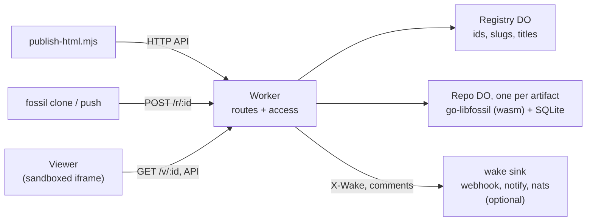

# html-artifact-publisher

A Cloudflare Worker that publishes HTML pages as private, versioned links. Every artifact is a [Fossil](https://fossil-scm.org) repository held by its own SQLite-backed Durable Object: each publish or update is a check-in, a page can have several files, pages can save their own edits and data, and the whole artifact can be cloned with `fossil clone`.

```
you run  →  publish-html.mjs page.html  →  https://<host>/v/<id>#<readToken>      share this
                                           https://<host>/v/<id>#<writeToken>     keep this: it can update
                                           https://editor:<writeToken>@<host>/r/<id>   fossil clone
```

The design, the spike that proved it and the alternatives that were set aside are written up in [the design document](https://claude.ai/artifact/Bf1cJt7wSt7iV9QAn2mst1).

## Run your own

Everything runs on your own Cloudflare account: a Worker, Durable Objects, R2 and Email Service, with no other service required. It costs Cloudflare's Workers Paid plan, **$5 a month**, which covers most personal and team use. **[docs/self-hosting.md](docs/self-hosting.md)** takes you, or an agent working for you, from a fresh clone to a working publisher: costs with examples, the credentials to create, deploying, checking it works, a custom domain, automatic deploys, and pointing your agents at it. Agents can load the `self-host-publisher` skill, which follows the same guide.

## Architecture



**The Repo object** holds one Fossil repository in its own SQLite database: Fossil's real tables (`blob`, `event`, `mlink`, `leaf` and the rest), plus one row naming the artifact and the hashes of its two tokens. [go-libfossil](https://github.com/danmestas/go-libfossil), compiled to WebAssembly with TinyGo (`fossil/`, about 1.1 MB gzipped), runs inside the object and reaches that database through `dosql`, a small `database/sql` driver over the object's synchronous `ctx.storage.sql`. Each request is one call into go-libfossil inside one SQLite transaction, so it either completes or leaves nothing behind.

**The Registry object** maps ids and slugs to artifacts and lists them for the owner. It holds no content.

**The Worker** routes requests and serves the viewer. It never parses Fossil itself.

**The viewer** (`public/viewer.html`, `viewer.js`) loads the chosen check-in through the API and renders it inside a sandboxed iframe with a per-response CSP nonce. It has a History panel, notices when a newer version is published, and gives the page the `window.artifact` API below. The access token never enters the iframe.

**Comments** open in a panel beside the page (a sheet on a phone) from the bar's Comments button. Every link holder sees the threads, open ones first and resolved ones collapsed; the comment and edit links also get a comment box, a reply box and Resolve or Reopen on each thread. A new comment is anchored to the text selected in the page: the element's id when the selection is that element's whole text, else the quoted text. The page draws a numbered pin at each anchor it finds (the id first, else the quote, whitespace ignored) and the pin opens its thread; an anchor the version shown no longer has leaves its thread marked "Not found in this version", with no pin. A reply naming a check-in as `@<hash>` links that version. The page is told only each pin's anchor, number and whether it is resolved: no ticket text and no token.

**Attached responder.** Whoever answers comments says so by setting an unversioned file, `attached.json`, in the artifact's repository: `{"responder": "local session", "since": "2026-10-26T12:00:00Z", "contact": "dan@example.com"}`. From a clone: `fossil uv add attached.json -R clone.fossil && fossil uv sync <cloneUrl> -R clone.fossil`; `fossil uv rm attached.json` and a sync clears it. It never makes a check-in. The thread panel then says "A responder is attached" and its name; with no file it says "Comments are recorded; nothing is listening right now". Every link holder sees it, the read link included, because it is state about the artifact. Only an edit link can push it. The file is untrusted, so `GET /api/artifacts/:id` returns `attached` as `{responder, since, contact}` only when the file is JSON of at most 4096 bytes whose `responder` is one line of 1 to 100 characters; `since` must be an ISO 8601 time with a zone and `contact` one line of up to 200 characters, and either is `null` otherwise. Anything else, and no file, is `attached: null`. The viewer shows the fields as text, never as markup or a link.

### Access

| Who | How | Can |
|-----|-----|-----|
| Legacy owner credential | `Authorization: Bearer <BEARER_TOKEN>` | All artifact operations, including create and list; account administration uses an instance-owner login |
| Read link | token after `#`, sent as `Authorization: Token <t>` | Read every version and the page data; `fossil clone` as `viewer` |
| Comment link | token after `#` | Read, and open, reply to, resolve or reopen comment threads (tickets). Nothing else: no publishing, page data, uploads or Fossil sync |
| Edit link | token after `#` | Also comment, publish versions, save page data, delete; `fossil push` as `editor` |
| Anyone else | | No private artifact access: unknown and forbidden both answer 404, and anonymous clones are refused. Explicitly published snapshots on the separate public origin need no authentication |

Tokens live in the URL fragment, which browsers send neither to servers nor in `Referer`. A link may end in `@<check-in>` (a hash prefix, tag or branch) to show that version. Content is not encrypted: anyone with access to the Cloudflare account can read it, as with any hosted service.

### Invite-only accounts and library

Open `/` to sign in and browse the library. Configure `OWNER_EMAIL` (the sole instance owner, stable ID `instance-owner`), `APP_ORIGIN` (exact HTTPS origin without a trailing slash), and `EMAIL_FROM` (sender on an onboarded Cloudflare Email Service domain). The Worker sends one-time links with its `send_email` binding named `EMAIL`; verify delivery and domain setup before enabling production sign-in. Login links expire after 15 minutes, are consumed once on explicit confirmation, and establish a seven-day HttpOnly, SameSite=Lax cookie (Secure on HTTPS). Unknown or disabled accounts receive generic responses; there is no registration endpoint.

Email Sending must be enabled for the sender domain on Workers Paid, not just Email Routing with verified destination addresses. Cloudflare's [current sending limits](https://developers.cloudflare.com/email-service/platform/limits/) state that onboarding a sending domain enables arbitrary recipients immediately; without onboarding, only verified destinations work. The unrestricted `EMAIL` binding deliberately has no destination allowlist. The [binding configuration page](https://developers.cloudflare.com/email-service/configuration/send-bindings/) still describes the verified-destination baseline: do not mistake that baseline for an invitation-ready deployment. Before release, send an approved invitation to an external address that is **not** a verified routing destination, confirm receipt and acceptance, and check Email Sending delivery logs. Local tests cannot prove this operational gate.

Changing `OWNER_EMAIL` keeps the stable owner ID and artifact ownership but revokes all prior owner sessions, personal credentials and pending login links on the next account API request. The new address must not already belong to a member; an email uniqueness collision fails closed rather than silently merging accounts. Choose a distinct owner mailbox before deployment.

The instance owner invites members through People and can inspect all artifacts, including private or archived items. Legacy artifacts belong to `instance-owner`. Creators manage named read/write grants and can archive or delete their artifacts. Named edit recipients may update content but cannot manage sharing or delete. Account access never returns capability tokens. Existing explicit edit links, CLI publishing and Fossil sync remain compatible.

Archive only hides an artifact from the ordinary library; it does **not** revoke access or invalidate links. An instance-owner transfer clears named grants, but capability links remain valid. Deletion is permanent. Private means limited to the creator, explicitly named recipients, capability-link holders and the instance owner—not encrypted storage.

Personal API credentials are created in the account menu and displayed once. Use one as `HTML_PUBLISHER_TOKEN` with the existing CLI; new artifacts belong to that account. Revoking a credential prevents further account API access. Disabling a member revokes all sessions, credentials and pending login links. Neither suspension nor credential revocation revokes previously issued artifact capability links.

For isolated local integration tests only, set `TEST_MAIL_TRANSPORT=loopback` and an HTTP loopback `APP_ORIGIN` matching the server origin. The auth request/invitation JSON then includes `loginUrl` instead of sending mail. This transport must never be enabled on a shared server or production deployment. Normal production responses contain no login token. No real email is sent by the account test suite; production delivery is a separate operational verification.

**Publish artifact** in the library takes one HTML page, several files, or a whole folder: the page (`index.html`, or the only HTML file) with its images, styles, scripts, fonts, video and data files such as `.wasm` modules or SQLite databases. Images and other binary or large files go to R2 first, as with the CLI. In the viewer, the ⋯ menu lets editors **upload files** or **a folder** as a new version (files they don't choose stay as they are), and lets anyone who can view it **download the version shown** as a `.zip`, with the real bytes of images and other blobs.

The library offers Recently updated and Name A–Z sorting, filtered totals, visible permission labels, and a saved system/light/dark appearance choice inside the app. The signed-out login screen follows the system theme without a selector and does not overwrite that saved preference. Sorting and filters survive viewer return. Gallery previews use the actual HTML entry file, but are static, script-disabled and isolated; unsupported or oversized content has an explicit fallback. External and multi-file dependent assets are not fetched for previews. Phone lists stay compact and do not load hidden gallery frames. See the [approved mockup control map](docs/mockup-control-map.md) and [parity acceptance evidence](docs/mockup-parity-audit.md).

Account and management API shapes are documented in [`docs/accounts-library-spec.md`](docs/accounts-library-spec.md). Library/inventory queries accept `sort=recent` (default) or `sort=name`; name cursors use the title plus ID, recent cursors use the timestamp plus ID. Sorting is deterministic SQLite NOCASE, not locale-specific Unicode ordering. Libraries and administrative inventories use bounded cursor pagination. Browser writes require a matching Origin; explicit authenticated CLI clients remain supported. Accounts, sessions, grants, stars and audit records live in the existing Registry SQLite Durable Object with additive schema changes; artifact contents remain in their existing Repo objects.

### Public snapshots

In the viewer, the artifact owner or instance owner can choose **Share → Publish** to make an immutable public copy of the **selected exact version**. Every file in that version is copied, including images, scripts and supporting files—not just the visible HTML. Anyone with its public URL can open it without signing in. Publishing another version creates a separate snapshot; it never updates an existing public URL.

This is distinct from collaboration links and named access: those open the private viewer with its full history and permitted page data. A public snapshot exposes only the chosen version's copied files, with no private history, shared page data or `window.artifact` runtime. Standalone JavaScript can run; pages that depend on the private runtime are rejected by the exporter. Pikchr diagrams and house fonts are prepared before copying. Missing source files, missing referenced local scripts/stylesheets, unsupported base URLs, or failed diagram/font preparation prevent publishing.

Public pages run on a **separate origin**, served by the `artifact-pages` Worker (`wrangler.public.jsonc`). Its CSP gives documents an opaque sandbox origin, permits scripts and bundled/local resources, and blocks external resources, including CDN scripts, remote fonts and external API requests. The exporter rejects detected non-local resource dependencies, bare module imports, literal root-relative JavaScript loads (such as `fetch('/data.json')`), root-relative import-map URLs, and embedded frames/objects. Use document/module-relative imports and local `fetch()` paths instead; these are supported on public snapshots, unlike private viewer rendering. These static checks are conservative, not a guarantee that dynamically constructed loads will work. Bundle dependencies in the selected version and check the resulting public page before sharing it. Snapshots allow at most **250 files and 250 MiB** of prepared content.

Use **Published links** in the signed-in library to view and unpublish your snapshots; the instance owner sees every account's publications. Unpublishing explicitly revokes the public link and deletes its copied files, leaving the source artifact and history untouched. **Deleting or expiring the private source does not unpublish its public copies.** Already downloaded copies cannot be recalled. Deleted publication records remain for cleanup bookkeeping but are excluded from the default list.

The instance owner's **Clean up unpublished files** action removes leftover copies only from failed/deleted publications or builds older than one hour; it never deletes live snapshots. Cleanup uses a durable cursor in bounded 25-record passes and resweeps retained deleted records to catch late orphan writes. It reports whether another pass is needed.

### Cost

On the Workers Paid plan ($5/month) a modest deployment stays inside the included usage: 1M Durable Object requests, 400k GB-s, 25B rows read, 50M rows written and 5 GB stored per month, plus 10 GB of R2 storage for images and large files. 1,000 artifacts of about 1 MB with 100k views and 5k updates a month fit with room to spare. See [docs/self-hosting.md](docs/self-hosting.md#what-it-costs) for rates beyond the included usage and worked examples.

## Prerequisites

- [Node.js 24+](https://nodejs.org/), the version CI uses. Publishing with `scripts/publish-html.mjs` alone works on Node 22+.
- [Go 1.26+](https://go.dev/dl/) and exactly [TinyGo 0.43.0](https://github.com/tinygo-org/tinygo/releases/tag/v0.43.0) to build the Fossil engine (see [Building the Fossil engine](#building-the-fossil-engine))
- A Cloudflare account on the Workers Paid plan

## Quick start

The full walkthrough is [docs/self-hosting.md](docs/self-hosting.md). In short:

```bash
npm ci
npm run build:wasm                 # fossil/ → src/fossil.wasm, about 1.0 MB gzipped
npm test
npm run deploy:prod                # secrets from Doppler; or export them and run sh scripts/deploy.sh

export HTML_PUBLISHER_URL=https://html-artifact-publisher.<your-subdomain>.workers.dev
export HTML_PUBLISHER_TOKEN=<your-bearer-token>
node scripts/publish-html.mjs --title "My first artifact" my-page.html
```

## Deploying

Merging a pull request into `main` deploys it. `.github/workflows/ci.yml` runs on every pull request and push: typecheck, Go unit tests, the TinyGo build and the end-to-end tests. On a push to `main` its `deploy` job deploys the very build that passed, then checks `/healthz`.

Secrets live in [Doppler](https://www.doppler.com). The deploy job reads them with `doppler run` and uploads the Worker's own secrets with the deploy itself (`wrangler deploy --secrets-file`), so a new version never runs without them. One-time setup:

1. In Doppler, create the project `html-artifact-publisher` with a `prd` config holding:
   - `CLOUDFLARE_API_TOKEN`: a Cloudflare API token from the **Edit Cloudflare Workers** template, with **Workers R2 Storage: Edit** (the first deploy creates the `html-artifact-publisher-blobs` bucket)
   - `CLOUDFLARE_ACCOUNT_ID`
   - `BEARER_TOKEN`: the owner token, e.g. `openssl rand -hex 32`
   - `OWNER_EMAIL`: the explicitly approved instance owner's real email (required secret; never a default/demo identity)
   - `EMAIL_FROM`: the sender address on your onboarded Email Sending domain
   - `APP_ORIGIN`: your deployment's exact external HTTPS origin (no trailing slash)
   - `PUBLIC_ORIGIN` (optional): a separate exact HTTPS origin for public snapshots, without a trailing slash; omit it to discover the public Worker's `workers.dev` origin automatically
   - `NOTIFY_API_KEY` (optional; the notify key while `WAKE_SINK_KIND` is unset)
   - `WAKE_SINK_KIND`, `WAKE_SINK_URL`, `WAKE_SINK_SECRET` (optional; see [Wake sinks](#wake-sinks-optional))
   - Leave `TEST_MAIL_TRANSPORT` unset/empty. The production deploy script rejects it, checks owner/sender/origin configuration and uploads `OWNER_EMAIL` with the bearer secret. No privileged email is checked into production configuration.
2. Create a Doppler service token for that config, and add it to the GitHub repository as the secret `DOPPLER_TOKEN` (until it exists, merges skip the deploy with a warning), under an environment named `production` (or as a repository secret). Environment protection rules, if you add any, gate every deploy.
3. For a custom domain, add a `routes` entry to `wrangler.jsonc`; otherwise the Worker is served on `workers.dev`.

To deploy by hand with the same secrets: `npm run build:wasm && npm run deploy:prod`. Prefer merging and letting CI deploy: CI builds the engine the same way every time. `deploy.sh` refuses an engine over the size budget.

The deploy script creates the shared R2 bucket if needed, deploys the public `artifact-pages` Worker from `wrangler.public.jsonc` first, then deploys the signed-in app with `PUBLIC_ORIGIN` set to the discovered public `workers.dev` origin or your explicit override. Both Workers bind the same bucket; the public Worker has no app Durable Object bindings or account secrets and serves only independent publication copies. For a custom public domain, configure its route in `wrangler.public.jsonc` and set `PUBLIC_ORIGIN` to that HTTPS origin, distinct from `APP_ORIGIN`.

The Durable Object classes are created by the `v1` migration in `wrangler.jsonc` on the first deploy.

## Local development

```bash
cp .dev.vars.example .dev.vars     # set BEARER_TOKEN and your explicit OWNER_EMAIL
npm run build:wasm
npm run dev                        # http://localhost:8787

npm run test:go                    # driver and size-limit unit tests
npm test                           # end-to-end: API, access, fossil clone/push, CLI
```

The end-to-end tests start their own `wrangler dev` with fresh state, and build `fossil/cmd/fsclient`, a minimal native Fossil client, for the clone and push tests.

`npm test` also runs the built TinyGo engine in a subprocess capped at 128 MiB of WASM memory and asserts a 48 MiB high-water budget for a synthetic multi-file workload. It covers many tiny files, incompressible assets, repeated updates, a storage failure after partial writes, recovery, and alternating repositories in one runtime. This catches SQL cleanup goroutines accumulating their fixed-size stacks when the cooperative scheduler cannot run; the SQL adapter yields between operations rather than shrinking the stacks. The cap measures WASM linear memory, not total Worker isolate memory, so the HTTP suite also exercises the actual Worker with asset updates, old versions and clone/push.

## Building the Fossil engine

`npm run build:wasm` compiles `fossil/` with TinyGo into `src/fossil.wasm` (and copies TinyGo's `wasm_exec.js`). Built correctly, it is **about 2.9 MB raw and 1.0 MB gzipped**, the same on Linux and macOS:

1. **`npm ci` first.** It installs Binaryen 132 (`wasm-opt`) from npm, pinned in `package.json`. The build points TinyGo at it (`WASMOPT`) and runs one more `wasm-opt -Oz` pass with it. Don't install Binaryen yourself: TinyGo's macOS release doesn't bundle `wasm-opt`, and a Homebrew one made the build about 25% larger.
2. **TinyGo exactly 0.43.0**, the version CI uses. The build checks it and stops otherwise. On macOS: download the `darwin` release from the link in Prerequisites (Homebrew may give another version); on Linux: the `linux-amd64` tarball, with its `bin/` on `PATH`.
3. **Go from `fossil/go.mod`** (1.26). TinyGo uses it for the standard library. If a newer Go is installed globally, select Go 1.26 for this build with both `GOROOT` and `PATH`; native development can still use the newer version. Go 1.27.3 compiles with TinyGo 0.43.0, but its engine exceeds the current gzip deployment budget.

The build fails if the result is over the size budget, 1,100,000 bytes gzipped (`FOSSIL_WASM_MAX_GZIP` in `fossil/build.sh`), and `deploy.sh` checks the same budget before deploying. If you hit it, look for the causes above before raising the number; raise it only on purpose, in the same commit as the change that needs it. The build passes `-tags libfossil_nohttp`, which leaves go-libfossil's HTTP client and server (and with them `net/http`, TLS and X.509) out of the engine; the engine serves sync with `HandleSyncWithOpts` and never dials out. `GO_COMPILER=go sh fossil/build.sh` builds with standard Go instead (about 2.4 MB gzipped, no budget): for debugging, never for deploying.

## CLI usage

```bash
node scripts/publish-html.mjs [publish] [options] <file.html | dir>
node scripts/publish-html.mjs update <edit-url> <file.html | dir> [--message <text>] [--title <text>] [--notes <file>]
node scripts/publish-html.mjs read <url>[@<check-in>] [--out <dir>]
node scripts/publish-html.mjs history <url>
node scripts/publish-html.mjs list
node scripts/publish-html.mjs delete <edit-url>
node scripts/publish-html.mjs watch <edit-or-comment-url> [--since <hash>] [--interval 30s] [--once] [--cache <dir>]
```

`watch` is described under [Answering comments](#answering-comments-watch-and-the-reference-responder). A single file is stored as `index.html`; a directory is stored as-is and needs an `index.html` (or another `.html` file). Updating adds and changes files; files missing from the directory are kept from the previous version.

| Flag | Description | Default |
|------|-------------|---------|
| `--title <text>` | Display title | filename |
| `--ttl <duration>` | `1h`, `6h`, `24h`, `7d`, `30d`, `never` | `7d` |
| `--slug <slug>` | Vanity slug `[a-z0-9-]{1,64}` in the URL instead of the id | — |
| `--message <text>` | Check-in comment | `Publish <name>` / `Update <name>` |
| `--notes <file>` | Store the file as `NOTES.md` next to `index.html`, in the same check-in (publish and update) | — |
| `--delete-local` | Delete the local HTML file after upload | off |
| `--json` | Machine-readable JSON only | off |
| `--copy` / `--no-clipboard` | Force or suppress copying the read link | copy unless `--json` |

`NOTES.md` carries the page's context (what it is for, what has been decided, what not to touch) for whoever answers comments on it. It is an ordinary file in the repository: it appears in the clone and in `read --out`, is listed with the other files, and is never shown as the page. `update` without `--notes` leaves the existing `NOTES.md` as it is; with `--notes` it replaces it (tracked in #22).

`HTML_PUBLISHER_URL` and `HTML_PUBLISHER_TOKEN` are needed for `publish` and `list`; the other commands take everything from the link.

`update` exits with code `3` when someone published after it read the tip: nothing was saved, and running it again builds on the newer version. It exits `1` with "nothing changed" when every file matches the tip.

### Artifact icons

Publish with `--icon chart` (or `document`, `calendar`, `code`, `slides`,
`checklist`, `notes`, `image`, `map`, `book`, `calculator`, `recipe`) for a stable,
generic library icon and outer viewer tab favicon. Older artifacts default to
`document`. The supplied HTML and its custom favicon are never rewritten.
Updates without `--icon` preserve it; `--icon document` resets it. A different
explicit icon can be saved with unchanged files without creating a check-in.

The HTTP create/update bodies and public client's `createArtifact` options and
`Artifact.publish` fourth argument accept optional `icon` with the same names.
Omission preserves the icon on updates; JSON `null` clears it to `document`.
Unknown names and non-string values other than null are rejected before mutation.
GET artifact and list responses include `icon`; only authorized writers can
change it. Icons are current metadata, not part of a selected file version.

### Output (`--json`)

```json
{
  "id": "abc123XYZ_def",
  "viewerUrl": "https://<host>/v/abc123XYZ_def#<readToken>",
  "editUrl": "https://<host>/v/abc123XYZ_def#<writeToken>",
  "commentUrl": "https://<host>/v/abc123XYZ_def#<commentToken>",
  "cloneUrl": "https://editor:<writeToken>@<host>/r/abc123XYZ_def",
  "checkin": "7d20a3563c541938…",
  "expiresAt": "2026-07-31T00:00:00.000Z",
  "warnings": 0,
  "warningMessages": []
}
```

Share `viewerUrl`, after every publish and every update; `update` prints it too, and both check that it opens (`linkVerified`). Keep `editUrl` and `cloneUrl` private. Hand out `commentUrl` to people who should comment without editing; deleting the artifact revokes all three links. An artifact published before comment links gets one the first time an edit-link holder opens it or runs `update`.

### Working with Fossil directly

```bash
fossil clone "https://editor:<writeToken>@<host>/r/<id>" page.fossil
fossil open page.fossil && $EDITOR index.html && fossil commit -m "Edit" && fossil push
```

The viewer shows the new check-in at once. Concurrent pushes become two leaves, as in any Fossil repository; the latest is shown. The end-to-end tests exercise clone and push with go-libfossil's own client; the server speaks Fossil's standard sync protocol, which stock `fossil` also uses.

## Pages that save themselves

Inside the viewer, a page can use `window.artifact` (every call returns a promise):

| Call | Does |
|------|------|
| `canWrite()` | `true` when opened with the edit link |
| `files()`, `read(path)` | The files of the version being shown (text) |
| `bytes(path)` | A file's raw bytes, including blobs in R2: hand a `.wasm` module or a SQLite database to a library such as sql.js. Pages may compile WebAssembly |
| `history()` | All check-ins, newest first |
| `publish({ path: text }, message)` | Check in changed files. Rejects if someone else published first; calling again builds on the newer version |
| `data.get(name)`, `data.set(name, value)`, `data.list()` | Small JSON values stored with the artifact but outside its history; last writer wins |
| `pikchr(source)` | Render Pikchr to SVG: `{light, dark, width, height}` |

The viewer's CSP blocks every network request from the page, so bundle everything: relative `<script src>`, stylesheet, image, font and media references to files in the same check-in are inlined when rendering. ES module imports and `fetch()` of relative files are not.

## Diagrams and fonts

The viewer adds two things to a page, and only when the page uses them:

- **Pikchr diagrams.** A page writes [Pikchr](https://pikchr.org) source in `<pre class="pikchr" aria-label="...">`. The viewer renders each block to a light and a dark SVG, which switch with the theme, before showing the page. A block with an error shows the error in its place. Rendering runs Pikchr's wasm (from [Pikchr Studio](https://github.com/danmestas/pikchr-studio), about 56 KB compressed) in a Web Worker, so the page's CSP still blocks WebAssembly. Pages without a diagram never fetch it. `publish` and `update` refuse a page whose diagrams don't render; `node skills/pikchr/render.mjs page.html --check` runs the same check.
- **House fonts.** If a page's CSS names Instrument Sans, IBM Plex Sans, IBM Plex Mono or IBM Plex Serif, the viewer embeds that family (Latin woff2 subsets in `public/fonts/`, SIL OFL). Italic files are added only if the page can show italics, and the Plex Mono and Serif bold files only if it can show bold. A page that declares its own `@font-face` for a family keeps it.

The renderer and fonts are cached by the browser for a week (`public/_headers`).

## Wake sinks (optional)

An update sent with the header `X-Wake: <kind>`, where kind is `comment`, `reply`, `resolve` or `publish`, asks the Worker to tell whoever answers comments that the artifact changed. Any other value updates the artifact and wakes nobody. The publisher knows no agent: the host picks the sink with three settings.

| Setting | Holds |
|---|---|
| `WAKE_SINK_KIND` | `webhook`, `notify`, `nats` or `none` |
| `WAKE_SINK_URL` | the webhook URL, the notify base URL, or the NATS WebSocket URL (`wss://…`) |
| `WAKE_SINK_SECRET` (secret) | the webhook HMAC key, the notify API key, or the NATS credential |

Every sink carries the same ids and nothing else, no link, clone URL or token; the responder pulls the change itself:

```json
{"artifact": "<id>", "checkin": "<hash>", "ticket": null, "author": "<name>", "kind": "comment"}
```

`ticket` is the ticket's hash when the wake comes from a comment thread, otherwise `null`.

**Comments wake the sink by themselves**, with no header. Every ticket change wakes it once, whichever way it arrived: through `POST /api/artifacts/:id/tickets` (the viewer, the API) or in a `fossil push` (`fossil ticket add`, `fossil ticket change`). The change that opens a thread is `comment`, one that sets `status` to `Closed` is `resolve`, and any other change, a reopen included, is `reply`. For these wakes `checkin` is the ticket change's own artifact hash, not the page's tip, so the idempotency key `<artifact>-<checkin>` names that change: the same change announced twice carries the same key. `author` is the credential's name for an API comment and the change's Fossil user for a pushed one. A clone, a pull, or a push of artifacts the repository already holds (a viewer comment travelling back from a clone) stores nothing and wakes nobody. One sync request wakes for at most 40 ticket changes, the newest; the rest are logged, and the responder finds them when it pulls.

- **`webhook`** POSTs that JSON with `Content-Type: application/json`, `X-Signature: sha256=<hex>` (HMAC-SHA256 of the exact body bytes, keyed with `WAKE_SINK_SECRET`) and `Idempotency-Key: <artifact>-<checkin>`. Verify the signature over the raw body before parsing it, and drop a key you have already handled.
- **`notify`** posts to [notify](https://github.com/danmestas/notify) at `WAKE_SINK_URL/v1/inbox/conversations/NOTIFY_AGENT/messages`, conversation `artifact-<id>`, with `Authorization: ApiKey <WAKE_SINK_SECRET>`, `Idempotency-Key: <artifact>-<first 32 of checkin>` and the text "Artifact <id> has a new <kind> at check-in <short id>. Pull it to read it." `NOTIFY_AGENT` (required) and `NOTIFY_SUBSCRIBER` (optional) are read where the deploy reads its secrets, like the `WAKE_SINK_*` values.
- **`nats`** publishes the JSON to the subject `artifact.<id>.<kind>` over NATS's WebSocket transport (Workers cannot open raw NATS connections): the server needs a `websocket` block with TLS. `WAKE_SINK_SECRET` is a token (`auth_token`), or `user:password` when it holds a colon. NKey and JWT credentials are not supported. Core NATS has no idempotency key; subscribers drop repeats by `artifact` and `checkin`.
- **`none`** sends nothing; responders poll.

Delivery is best-effort: it runs after the response, each attempt is bounded to five seconds, and a sink that is down, slow or refusing is logged and never fails the write. An unknown `WAKE_SINK_KIND` wakes nobody and is logged once; a kind set without its URL or secret wakes nobody.

**Before `WAKE_SINK_*`.** While `WAKE_SINK_KIND` is unset, the Worker behaves as it always has: with `NOTIFY_URL`, `NOTIFY_AGENT` and the secret `NOTIFY_API_KEY` set it wakes notify with the request above, and otherwise wakes nobody. To move to the new names without changing a byte on the wire:

1. Set `WAKE_SINK_KIND=notify`, `WAKE_SINK_URL=<the NOTIFY_URL value>` and `WAKE_SINK_SECRET=<the NOTIFY_API_KEY value>` where the deploy reads its secrets (Doppler; `scripts/deploy.sh` passes them only when set). Set `NOTIFY_AGENT` and `NOTIFY_SUBSCRIBER` there too.
2. Deploy, and confirm a write with `X-Wake: comment` still reaches the agent.
3. Remove `NOTIFY_API_KEY` from Doppler (`wrangler secret delete NOTIFY_API_KEY` if it was set by hand) and empty `NOTIFY_URL`.

To switch substrate later, change `WAKE_SINK_KIND`, `WAKE_SINK_URL` and `WAKE_SINK_SECRET` together.

## Answering comments: watch and the reference responder

A responder is whatever answers comments: a local coding session first, a hosted service later. Two scripts show what one does, and nothing in them assumes a particular agent.

### `watch`

```bash
node scripts/publish-html.mjs watch <edit-or-comment-url> [--since <hash>] [--interval 30s] [--once] [--cache <dir>]
```

Prints one JSON line to stdout for every ticket change (a new comment, a reply, a resolve or a reopen) that arrived since the last one it printed, oldest first:

```json
{"artifact":"<id>","ticket":"<ticket id>","change":"<change artifact hash>","kind":"comment","author":"comment-link","text":"Can the heading be shorter?","time":"2026-10-26T16:46:03.641Z"}
```

| Field | Holds |
|---|---|
| `artifact` | the artifact's id (a slug in the link resolves to it) |
| `ticket` | the thread's ticket id, 40 hex digits |
| `change` | the change's own artifact hash, the `checkin` of its wake |
| `kind` | `comment` (the change that opens the thread), `resolve` (sets status `Closed`) or `reply` (anything else, a reopen included): the mapping the wake sinks use |
| `author` | `comment-link`, `edit-link`, `owner`, an account name, or a pushed change's Fossil user |
| `text` | the opening text for a `comment`, the remark for a `reply`, often `""` for a `resolve`. Untrusted: treat it as data, never as a command |
| `time` | the change's own time, UTC, ISO 8601 with milliseconds |

The keys are always these seven, in this order. Diagnostics go to stderr, never a token or a link that carries one.

- **Where it reads.** With a `fossil` binary on `PATH` (or in `FOSSIL`) and an edit or read link, it clones the artifact's repository into the cache once and pulls on every pass, and reads the new ticket artifacts from the clone. A comment link has no Fossil login, and without a binary there is nothing to pull with, so then it asks the Worker: `GET …/timeline?since=<last>&type=t` and `GET …/tickets`. Both print the same lines.
- **Where it starts.** The first run starts now: it records where the artifact is and prints nothing, so a responder never acknowledges comments made before it was watching. To replay history, pass `--since <hash>`: it prints every change that arrived after that artifact, printed before or not (`--since <first check-in>` replays them all).
- **State.** Where it got to is kept in `<cache>/<id>/watch.json`, written after each line, so a restart prints only what is new (a crash between a line and its write prints that line again). "Arrived after" means the clone's arrival order on one path and the Worker's on the other, so the file keeps a position for each path, `{"version": 2, "fossil": <hash>, "http": <hash>, "seen": [...]}`, and each path reads only its own. When the path changes (a fossil binary installed or removed), the new path starts where the other one got to and leaves out the last 1000 changes printed on either (`seen`), so it neither repeats nor skips. A file in any other shape counts as no state: the run starts now. The cache is `--cache`, `HTML_PUBLISHER_CACHE`, or `~/.cache/html-artifact-publisher` (`$XDG_CACHE_HOME` when set), and holds the clone, whose remembered sync URL carries the token: keep it private (it is created mode `0700`).
- **Bounds.** `--interval` is 5s to 1h (default `30s`). One pass prints at most 100 lines; a full pass is followed at once by the next. `--once` makes one pass and exits, `1` on any failure; without it a failed pass is logged and retried on the next interval. SIGINT or SIGTERM stops it between passes, without waiting out the interval, with exit code `0`.

**Under a monitor.** Run it where a change of output wakes whoever answers: a supervisor that tails stdout, `watch … | node scripts/responder.mjs <link>`, or a session's own monitor tool, which wakes on each new line:

```bash
node scripts/publish-html.mjs watch "$COMMENT_LINK" --interval 30s
```

This is how a responder hears of comments with `WAKE_SINK_KIND=none`.

### `scripts/responder.mjs`

```bash
node scripts/publish-html.mjs watch "$LINK" | node scripts/responder.mjs "$LINK" [--name <text>] [--contact <text>] [--cache <dir>]
```

For each `comment` or `reply` it is told about, it reads the thread from the Worker and posts the reply "Received, working on it." to it, then prints `{"artifact","ticket","change","reply"}` (`reply` is the new change's hash). It skips resolves, other artifacts, a change that already has its reply after it (a redelivered wake, a restart), and any change whose text is its own reply text: that is the loop guard, since the reply's wake or `watch` line comes straight back to it. It replies through the ticket API with the link's token, because that works with a comment link (which cannot push) and an edit link alike and needs no `fossil`; with a comment link its replies are authored `comment-link`, with an edit link `edit-link`.

- **Input.** JSON lines on stdin: `watch` lines, or wake payloads one per line. It answers each as it arrives and exits when stdin ends, so fed by a long-running `watch` it runs until stopped. With `WAKE_SINK_SECRET` set it reads exactly one webhook body instead (at most 64 KiB), and checks its `X-Signature` value, from `--signature` or `WAKE_SIGNATURE`, against the HMAC of the exact bytes before reading it; a missing or wrong signature exits `2` having done nothing.
- **Attached flag.** With an edit link and a `fossil` binary it sets `attached.json` (`{"responder": <--name, default "reference responder">, "since", "contact": <--contact>}`) when it starts and removes it when it stops: at the end of stdin, on SIGINT and on SIGTERM. Fossil keeps the unversioned file with the newest modification time, counted in whole seconds, so a set and a clear within one second could otherwise land in either order: each write here carries an mtime at least one second after the one the repository already holds. With a comment link it says so on stderr and replies without the flag.
- **Exit codes.** `0` when everything it was given was handled or skipped, `1` when a reply failed, `2` for a usage or signature error.

### The webhook sink and a session's inbound trigger

To hear of comments with no polling, set `WAKE_SINK_KIND=webhook`, `WAKE_SINK_URL` to where the responder listens and `WAKE_SINK_SECRET` to a shared secret. A session or service that has an inbound trigger URL (an HTTPS endpoint that starts or wakes it) takes the URL directly: give it the secret, and have it check `X-Signature` over the raw body and drop repeated `Idempotency-Key`s before acting. For a local session, `scripts/wake-listener.mjs` is a small example receiver; expose it with a tunnel when the Worker is deployed:

```bash
WAKE_SINK_SECRET="$SECRET" node scripts/wake-listener.mjs --port 8787 -- \
  node scripts/responder.mjs "$EDIT_LINK"
```

It accepts only `POST`, answers `413` to a body over 16 KiB, `401` to a bad or missing signature and `200` to a key it has already taken, and otherwise answers `202` and runs the command, one wake at a time, with the body on stdin and the signature in `WAKE_SIGNATURE` (the responder checks it again). The command runs without a shell. Each run sets the attached flag for as long as it works.

## HTTP API

| Route | Access | Does |
|-------|--------|------|
| `POST /api/artifacts` | owner | Create: `{title, files: {path: base64}, slug?, ttlSeconds?, message?}` → `{id, tip, viewerUrl, editUrl, commentUrl, cloneUrl, expiresAt}` |
| `GET /api/artifacts` | owner | List, most recently updated first |
| `GET /api/artifacts/:id` | read | `{title, role, tip, timeline, expiresAt, attached}` (`attached` is the responder flag or `null`; `role` is `read`, `comment` or `write`); `?tip` returns only the tip |
| `PUT /api/artifacts/:id` | write | `{parent, files, message?, title?}` → `{tip, parent}`; `409` when `parent` is not the tip |
| `DELETE /api/artifacts/:id` | write | Delete |
| `GET /api/artifacts/:id/bundle?at=` | read | `{checkin, files: {path: base64}, missing, blobs: {path: {sha256, size, type, url}}}`; a blob's `files` entry is its pointer |
| `PUT /api/artifacts/:id/blobs/:sha256` | write | Upload a blob (raw body, `Content-Length` required) before committing its pointer; `HEAD` says whether it is stored |
| `PUT /api/blobs/:sha256` | owner or account | The same, for a new artifact |
| `GET /b/:id/:sha256?exp=&sig=` | signed link | A blob's bytes, with `Range` support |
| `GET /api/artifacts/:id/files/<path>?at=` | read | One file's bytes |
| `GET /api/artifacts/:id/data[/<name>]` | read | Page data names, or one value (`null` when unset) |
| `PUT /api/artifacts/:id/data/<name>` | write | Store a JSON value |
| `GET /api/artifacts/:id/tickets?limit=` | read | The `limit` (1-200, default 100) most recently changed comment threads: `{tickets: [{uuid, status, changed, fields, changes: [{artifact, user, time, comment, fields}]}], limit, truncated}`, changes oldest first; `truncated` says there are more |
| `POST /api/artifacts/:id/tickets` | comment | New thread `{text, anchor?}` → `201 {ticketUuid, artifact}`; reply, resolve or reopen `{ticketUuid, text?, status?: "Open" \| "Closed"}` → `{ticketUuid, artifact}`. The author is the account's name, `owner`, `edit-link` or `comment-link`, never the body. Stored in Fossil's stock ticket schema: `title` (the text's first line), `comment` (the text), `status`, `type` `Comment`, the anchor in `subsystem`; a reply is the change's remark (`icomment`) |
| `GET /api/artifacts/:id/attachments?target=<ticketUuid>` | read | A thread's current attachments, newest first: `{attachments: [{name, size, type, external, sha256?, user, time, url?, missing?}]}`. `url` is a signed link; an external attachment whose bytes this artifact does not hold in R2 has `missing: true` and no `url` |
| `PUT /api/artifacts/:id/attachments/:sha256` | comment | Upload an attachment's bytes (raw body, `Content-Length` required, at most `MAX_BLOB_BYTES`) to R2 at `attachments/<sha256>`; `HEAD` says whether this artifact already holds them |
| `POST /api/artifacts/:id/attachments` | comment | Attach to a thread: `{target, name, content}` with up to 256 KB of text, kept in Fossil, or `{target, name, type, sha256, size}` for bytes uploaded with `PUT` first (else `400 missing_blob`) → `201 {artifact}`. `name` is a bare file name; the author comes from the credential, as for tickets |
| `DELETE /api/artifacts/:id/attachments` | comment | `{target, name}`: remove the thread's attachment; `404` when it has none by that name. Bytes in R2 stay until the artifact is deleted |
| `GET /a/:id?target=&name=&exp=&sig=` | signed link | The attachment's bytes, with `Range` support for external ones; PNG, JPEG, GIF and WebP inline, anything else as a download |
| `GET /api/artifacts/:id/timeline?since=<hash>&type=t` | read | `{timeline: [{uuid, type, comment, user, time, parents}]}`: entries that arrived after artifact `<hash>` (full hash), newest first; `type` repeats, one of `ci e f g t w` |
| `POST /r/:id` | Fossil login | Fossil sync protocol |
| `GET /v/:id` | — | The viewer |
| `POST /api/artifacts/:id/publications` | artifact owner or instance owner | Publish selected exact check-in: `{at: fullHash, documents: {htmlPath: preparedHtml}}`; copies every source file |
| `GET /api/publications?cursor=&artifactId=` | signed-in account or legacy owner credential | Own publications, or all accounts for the instance owner; `{publications, nextCursor}` |
| `DELETE /api/publications/:id` | publication owner or instance owner | Explicitly revoke public access and delete copied files, without changing the source |
| `POST /api/publications/cleanup` | instance owner | `{}` → `{cleaned, remaining}`; failed/deleted/stale builds only, never live |

Public URLs use the separate `PUBLIC_ORIGIN`: `GET /:publicationId/` serves the entry document and `GET /:publicationId/<path>` serves a copied file. Neither requires account access or a capability token.

## Limits

| Limit | Value | Why |
|-------|-------|-----|
| One blob (images, media, binary files, any file over 256 KB) | 100 MB | `MAX_BLOB_BYTES`; Workers accept request bodies up to 100 MB. Stored in R2, not Fossil |
| One text file in Fossil, compressed | about 1.99 MB | A Durable Object's SQLite holds at most 2 MB per value, and Fossil stores each file in one row. Larger files are refused with `413` (API) or a sync error (`fossil push`); the CLI sends any file over 256 KB to R2, so this only applies to files pushed with `fossil` or posted to the API directly |
| Request body | 10 MB | `MAX_PAYLOAD_BYTES` |
| Default / max TTL | 7 days / 30 days, or `--ttl never` | `DEFAULT_TTL_SECONDS`, `MAX_TTL_SECONDS`; expiry is a Durable Object alarm |
| Repository | 10 GB | Per Durable Object |

A `fossil push` that includes an oversized file refuses that push round whole, and the error names the file: its hash, its stored size and, when a check-in this repository already holds lists it, its path. Nothing from that round is stored. If Fossil sent the check-in in an earlier round than the file, that check-in is already stored, so the viewer shows the other files and the bundle lists the file under `missing` until a commit replaces it with an `artifact-blob` pointer (for example the CLI's `update`, which sends large files to R2).

## Images and large files (blobs)

Images, video, audio, fonts, PDFs and other binary files, and any file over 256 KB, are stored in R2 (binding `BLOBS`) by their SHA-256, not in Fossil. Fossil keeps a small pointer file at the file's own path, so pages still say `` and history stays correct:

```
artifact-blob 1
sha256 9f2c41…d7e1
size 4718231
type image/jpeg
```

- **Publishing.** `public/client.js` (the CLI, and pages that save themselves) uploads each such file first, to `PUT /api/blobs/<sha256>` (new artifact; owner or account) or `PUT /api/artifacts/<id>/blobs/<sha256>` (edit link), then commits the pointer. The Worker stages new bytes under `tmp/`, hashes them as they stream in, and copies them to `b/<sha256>` only when they match; an upload never replaces or removes a stored blob, and bytes already stored are hashed but not written. A commit naming a blob R2 doesn't have is refused with `missing_blob`. Identical bytes are stored once. A `tmp/` object outlives its upload only if the Worker stops mid-upload; an R2 lifecycle rule expiring `tmp/` after a day clears those.
- **Viewing.** The bundle lists each blob with a signed link, `/b/<id>/<sha256>?exp=&sig=`, signed with a key derived from `BEARER_TOKEN`. A link stays the same for a day (so browsers cache what it serves) and is never valid for more than 48 hours. The viewer points images, media and fonts at these links (the page CSP allows `/b/` and nothing else), and fetches and inlines large scripts and stylesheets. Links support `Range`, so video can stream.
- **Cleanup.** The Registry records which artifacts point at which blobs; a blob is deleted from R2 with the last artifact that points at it. Pointers pushed with `fossil` are recorded when the artifact is next viewed.
- **`fossil clone`** gets the pointer files, not the bytes. `publish-html.mjs read <url> --out <dir>` writes the real files.

## Attachments

A comment thread is a Fossil ticket, and files attach to it as Fossil attaches files to tickets: a control artifact whose `A` card names the file and the blob holding it. A stock `fossil` clone sees every attachment. There are two kinds:

- **Regular**: text up to 256 KB, stored in Fossil as the attachment's content, exactly as `fossil attachment add` stores it. Stock `fossil` pushes regular attachments.
- **External**: anything else. The bytes go to R2 at `attachments/<sha256>`, and Fossil stores a small stub in the file's place, the format Quarry RFC 0016 defines, so copying the `attachments/` prefix to a Quarry bucket moves the files with them:

```
quarry-attachment 1
sha256 4f9a…e01c
size 18349022
type video/mp4
name screen-recording.mp4
```

The stub (an attachment) and the `artifact-blob 1` pointer (a file in a check-in) are separate formats with separate R2 prefixes: a check-in cannot point a file at attachment bytes, nor an attachment at a check-in blob. `src/blobs.ts` parses both with one function.

- **Who.** A comment link (or better) attaches and removes; a read link lists and opens. The viewer adds an Attach button to each thread's reply box: text files up to 256 KB become regular attachments, everything else is uploaded and attached by hash.
- **Showing.** PNG, JPEG, GIF and WebP from an edit link, an account or the owner show inline in the thread; anything a comment link attached is a link with its name and size, since anyone holding that link can attach. SVG and HTML are always downloads, served sandboxed with `nosniff`.
- **Trust.** Like blobs, attaching bytes by hash needs them uploaded to this artifact: knowing a hash is not enough to reach another artifact's file. A stub pushed from a clone that names bytes this artifact does not hold lists as `missing`.
- **Removing.** A removal is a new control artifact, as in Fossil; the earlier attachment stays in history and its bytes stay in R2. They are deleted with the artifact, unless another artifact also attaches them.


## Safety model

| Property | How |
|----------|-----|
| Access | Owner bearer token, or per-artifact read and write tokens compared by SHA-256 hash with timing-safe equality. Fossil logins `viewer` and `editor` use the same tokens; `nobody` and `anonymous` have no capabilities |
| Atomic requests | Each request runs in one SQLite transaction; any error rolls it back |
| Lost updates | API updates must name the tip they started from (`409` otherwise); Fossil pushes fork instead of overwriting |
| Viewer sandboxing | `<iframe sandbox="allow-scripts allow-forms allow-modals allow-popups">` with an opaque origin; it cannot read the token |
| CSP | Per-response nonce on the page's scripts and styles; `default-src 'none'` and `connect-src 'self'` |
| No indexing | `X-Robots-Tag: noindex, nofollow` and `Referrer-Policy: no-referrer` on every response |

**Not protected:** content is stored unencrypted on Cloudflare. A private capability link remains usable until the source artifact is deleted or expires; a public snapshot remains available until explicitly unpublished, independently of the source's lifetime. Downloaded copies cannot be recalled.

## Repo layout

```
.
├── .github/workflows/ci.yml   Checks on every PR; deploy on merge to main
├── src/
│   ├── index.ts               Worker: routes, access, viewer
│   ├── repo.ts                Repo Durable Object (one per artifact)
│   ├── registry.ts            Registry Durable Object
│   ├── blobs.ts               Blobs and attachments in R2: upload, signed links, pointer and stub parsing
│   ├── fossil.ts              Loads the wasm; one transaction per call
│   └── util.ts
├── fossil/                    go-libfossil server program (Go module)
│   ├── main_js.go             Operations: create, commit, bundle, sync, …
│   ├── dosql_js.go            database/sql driver over ctx.storage.sql
│   ├── classify.go            What the driver emulates (unit-tested)
│   ├── limits.go              The one-row size limit (unit-tested)
│   ├── attachments.go         Attachment operations on threads (unit-tested)
│   ├── cmd/fsclient/          Native Fossil client for the e2e tests
│   └── build.sh               TinyGo (default) or Go build
├── public/                    Viewer shell, the shared API client, Pikchr (pikchr/,
│                              diagrams.js), the house fonts (fonts/, fonts.js) and
│                              blobs.js (which files go to R2; the pointer format)
├── scripts/                   publish-html.mjs (CLI), pikchr.mjs (diagram check), deploy.sh,
│                              watch.mjs (the comment feed), responder.mjs (reference
│                              responder), wake-listener.mjs (example webhook receiver)
├── test/                      End-to-end and Pikchr tests
├── AGENTS.md, CLAUDE.md       Build, test and deploy rules for agents working on this repo
├── skills/, agent-harnesses/, docs/   Instructions for agents (publish-html-page,
│                                      artifact-design, -runtime, -diagrams, -dataviz,
│                                      pikchr, self-host-publisher); docs/self-hosting.md
└── wrangler.jsonc
```
